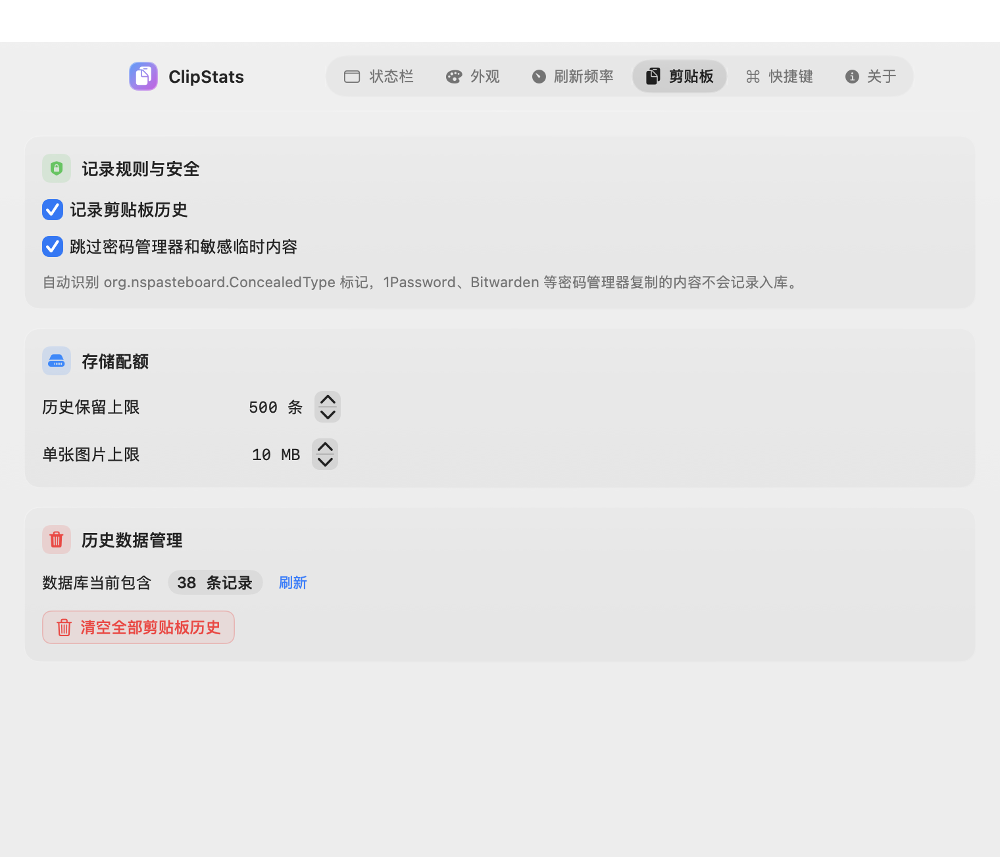
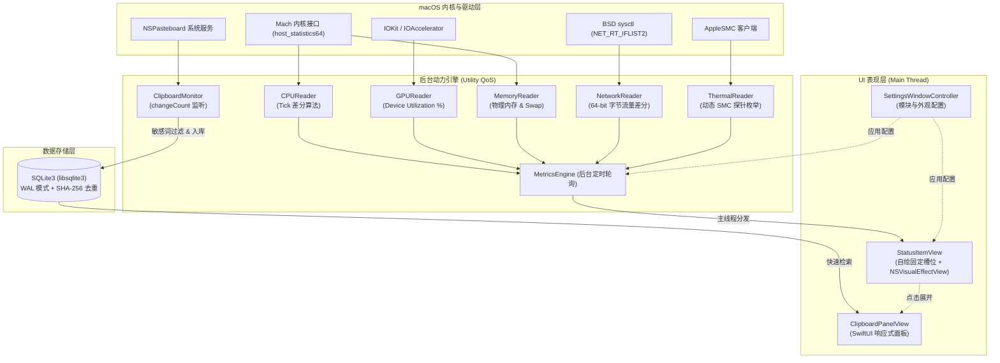
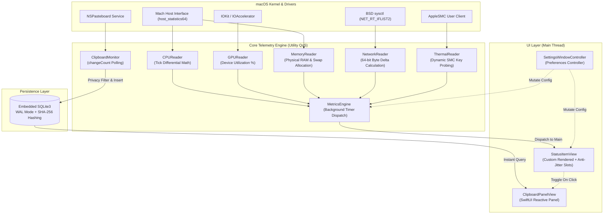

<div align="center">

# ClipStats

**极致轻量、原汁原味的 macOS 菜单栏系统监控与剪贴板管家**  
*A lightweight, native macOS menu bar system monitor & clipboard history manager.*

[](https://www.apple.com/macos/)
[](https://github.com/sagirilovely/ClipStats/releases)
[-F05138?style=flat-square&logo=swift&logoColor=white)](https://swift.org)
[](LICENSE)

<br />

**[ 简体中文 ](#-简体中文)** &nbsp;｜&nbsp; **[ English ](#-english)**

<br />


</div>

---

# 🇨🇳 简体中文

ClipStats 是一款专为 macOS 打造的高性能、低资源占用的常驻菜单栏工具。它将**实时系统状态监控**与**原生剪贴板历史管理器**天衣无缝地融为一体：无需庞大的第三方依赖，无需安装庞大的 Xcode，甚至无需授予辅助功能权限，便能享受丝滑、稳健且高度可定制的系统级体验。

---

## 目录
- [产品介绍](#-产品介绍)
  - [核心特性](#-核心特性)
  - [界面与视觉展示](#-界面与视觉展示)
  - [下载与安装](#-下载与安装)
- [技术实现](#-技术实现)
  - [设计哲学与整体架构](#-设计哲学与整体架构)
  - [内核指标采集引擎](#-内核指标采集引擎)
  - [剪贴板与隐私防护机制](#-剪贴板与隐私防护机制)
  - [无 Xcode 编译工作流](#-无-xcode-编译工作流)
  - [本地开发与诊断指令](#-本地开发与诊断指令)
  - [开源协议与鸣谢](#-开源协议与鸣谢)

---

## 🌟 产品介绍

### 核心特性

#### 1. 灵动且精准的菜单栏监控 (System Monitor)
- **六大状态模块**：实时侦测 **CPU 占用**、**GPU 占用**、**内存负载**、**核心温度**、**实时网速** 以及 **剪贴板条目数**。
- **模块自由定制**：每个指标均可独立开关，支持拖拽与上下箭头调整顺序；前缀标识支持 **SF Symbols 图标**、**文字标签** 或 **纯净隐藏**。
- **网速垂直双行布局**：独创网速上下排列模式（上传在上、下载在下），相较传统左右单行排列直接节约 **50% 菜单栏横向空间**。
- **防抖动固定槽位 (Anti-Jitter)**：各模块按最大可能数值预留固定物理槽位，彻底告别因网速从 `10 KB/s` 飙升至 `120 MB/s` 时菜单栏疯狂抖动扯拉界面的困扰。
- **多样化视觉背景**：支持原生跟随、**沉浸纯色**（自定义 HEX 与透明度）以及 **macOS 原生毛玻璃 (Liquid Glass)** 效果。

#### 2. 原生高效的剪贴板历史 (Clipboard History)
- **多类型数据无缝捕获**：自动且无感地记录所复制的**富文本、纯文本、图片素材与文件路径**。
- **瞬时检索与类型过滤**：支持关键词秒级搜索，提供「全部 / 文本 / 图片 / 文件」四路分类筛选标签。
- **置顶与智能去重**：常用片段一键置顶；重复复制相同内容时自动归拢并置顶，绝不产生垃圾冗余。
- **零辅助功能权限 (No AX Permissions)**：基于 macOS Carbon 底层全局热键 API（默认 `⌥⌘V`），无需在系统设置中反复勾选隐私辅助功能。
- **密码管理器隐私避让**：自动侦测并跳过带有 `org.nspasteboard.ConcealedType` 标记的敏感剪贴板内容（完美兼容 1Password、Bitwarden、KeepassXC 等）。

#### 3. 极简优雅的设置系统
- 外观、状态栏模块、刷新频率、剪贴板上限、快捷键等六大独立面板。
- 字体尺寸（10–16pt）、图标大小、左右边距、列间距、数值对齐（居中 / 靠右）毫米级微调。

---

### 🖼 界面与视觉展示

#### 状态栏样式变奏

| 文字标签风格 | 网速垂直双行（节省空间） |
| :---: | :---: |
|  |  |

| 经典纯色背景 | 原生毛玻璃背景 (Liquid Glass) |
| :---: | :---: |
|  |  |

#### 剪贴板历史面板与外观定制

| 原生剪贴板面板 (`⌥⌘V`) | 外观个性化设置 |
| :---: | :---: |
|  |  |

| 状态栏模块排序与配置 | 剪贴板历史选项与过滤 |
| :---: | :---: |
|  |  |

---

### 📦 下载与安装

#### 方式一：下载预编译发布包 (推荐)
前往 [GitHub Releases](https://github.com/sagirilovely/ClipStats/releases) 下载最新发行版：
- `ClipStats-<version>-macos-universal.zip` —— 通用架构归档，解压即可直接运行。
- `ClipStats-<version>-macos-universal.dmg` —— 传统拖拽安装盘镜像。

> [!TIP]
> **首次运行 Gatekeeper 提示处理**  
> 由于本项目为个人开源项目，采用 Ad-hoc 本地自签名（未加入每年 \$99 的 Apple Developer 计划）：  
> 1. 在 Finder 中**右键点击 ClipStats.app → 选择“打开”**，在系统安全确认弹窗中点击“打开”即可；  
> 2. 或在终端执行解除隔离属性指令：
>    ```bash
>    xattr -dr com.apple.quarantine /Applications/ClipStats.app
>    ```

#### 方式二：从源码一键构建安装
无需臃肿的 Xcode IDE，只要安装了 macOS 命令行工具即可在几十秒内编译完毕：

```bash
# 1. 确保已安装 Xcode Command Line Tools（未安装会弹出安装提示）
xcode-select --install

# 2. 克隆仓库并安装到 /Applications
git clone https://github.com/sagirilovely/ClipStats.git
cd ClipStats
make install
```

---

## 🛠 技术实现

ClipStats 追求极致的精简与效率，全工程为纯 Swift 原生打造，不引入任何重量级三方 Pod/SPM 包，构建产物精炼纯净。

### 架构全景



---

### 🔬 内核指标采集引擎

ClipStats 抛弃粗暴的命令行子进程调用（如 `top` 或 `netstat`），全面直连 macOS Mach 内核与 IOKit 驱动接口，极大降低 CPU 开销与电池能耗：

| 指标维度 | 底层接口 / 实现机制 | 关键技术考量 |
| :--- | :--- | :--- |
| **CPU 负载** | `host_statistics(mach_host_self(), HOST_CPU_LOAD_INFO, ...)` 与 `host_processor_info` | 统计 `user`、`system`、`idle`、`nice` 时间片滴答计数差分；支持各核心独立负载运算。 |
| **GPU 负载** | IORegistry `IOAccelerator` → `PerformanceStatistics` | 检索显卡硬件加速器实时 `Device Utilization %`，兼顾 M 系列统一内存核显与 Intel 核显。 |
| **物理内存** | `host_statistics64(HOST_VM_INFO64)` + `sysctl("vm.swapusage")` | 精确计算活跃页、联动页（Wired）、压缩内存（Compressed）并扣减文件缓存，精准还原系统监控级数值。 |
| **实时网速** | `sysctl(NET_RT_IFLIST2)` 读取 `if_msghdr2` | 遍历网络接口的 64 位 `ifi_ibytes` / `ifi_obytes`。采样周期算差分，支持高并发千兆网络而不溢出。 |
| **硬件温度** | IOKit `AppleSMC` 用户态客户端 (`IOServiceOpen`) | **创新型动态运行时键枚举**：启动时自适应探测匹配有效温度探针，打破不同 M 芯片架构键名不统一壁垒。 |

> [!NOTE]
> **关于 Apple Silicon 芯片温度枚举机制**  
> 苹果在不同架构（M1、M2、M3、M4 系列及 Max/Pro/Ultra 变体）中频繁重构 SMC 传感器键名（如部分 M1 机型无传统 `Tp01`，而是 `Tp2x...Tp9z`）。ClipStats 采用**动态自适应扫描分类器**，自动在运行时遍历 SMC 键表并聚类，读取失败时优雅降级为 `--`，绝不因未知传感器键导致崩溃。

---

### 🛡️ 剪贴板与隐私防护机制

1. **高性能本地存储引擎**
   - 依赖系统内置的 `libsqlite3` 动态链接库，零引入第三方 ORM 框架。
   - 开启 `PRAGMA journal_mode = WAL;`（预写日志），在保证高并发写入稳定性的同时，带来亚毫秒级的关键字全文检索体验。
   - 采用 `CryptoKit` 对大文本/多媒体数据进行 **SHA-256 摘要哈希去重**，仅索引新增条目或更新重复条目时间戳。

2. **严苛的隐私过滤标准**
   - 默认拦截并丢弃携带 `org.nspasteboard.ConcealedType`、`com.agilebits.onepassword` 等密码管理器标记的瞬时内容。
   - 数据完全保留在用户本地 `~/Library/Application Support/ClipStats/clipboard.db`，无网络上传、无统计打点、无云端同步泄露风险。

3. **零侵入 Carbon 全局快捷键**
   - 依托 Carbon 框架的 `RegisterEventHotKey` API，无需用户在系统偏好设置中开放危险的 Accessibility（辅助功能）注入权限，即可在任意前台应用下瞬间呼出面板。

---

### ⚡ 无 Xcode 编译工作流

现代 macOS 开发通常高度绑定数十 GB 的 Xcode，而新版 SwiftUI 宏（如 `@Observable` / `@State`）在独立编译器环境中存在工具链依赖痛点。

ClipStats 采用清晰优雅的**模型驱动架构**（`ObservableObject` + `@ObservedObject` / `@Binding`）：
- 仅依赖 **200MB+ 的 Command Line Tools**；
- 通过简洁透明的 `Makefile` 与 `swiftc` 编译器进行模块化单指令构建；
- 打包脚本通过 `lipo` 自动缝合 `arm64` 与 `x86_64` 产物，原生支持 Apple Silicon 与 Intel 双平台。

#### 常用构建命令清单

```bash
make build        # 快速编译二进制到 build/ClipStats
make bundle       # 组装 ClipStats.app 并完成本地 ad-hoc 签名
make run          # 一键重构、打包并立即拉起测试
make install      # 构建并安全同步至系统 /Applications 目录
make package      # 构建生产发布包 dist/ClipStats-<ver>-macos-universal.zip
make icon         # 执行 scripts/make-icon.swift 生成各尺寸矢量应用图标
make clean        # 清理 build 临时构建物与模块缓存
```

---

### 🩺 本地开发与诊断指令

ClipStats 内置了丰富的运行时诊断环境变量，方便开发者在没有 IDE Debugger 的场景下快速定位性能与布局问题：

```bash
# 开启指标高频日志，并校验菜单栏宽度是否发生像素级抖动
CLIPSTATS_DIAG=1 ./build/ClipStats

# 启动后自动弹出剪贴板历史面板（便于 UI 样式调试）
CLIPSTATS_DIAG_SHOW=panel ./build/ClipStats

# 离屏渲染当前各 UI 视图截图至 /tmp/shot-*.png
CLIPSTATS_DIAG_SHOW=snapshot ./build/ClipStats

# 调试各设置页外观与背景模式 (solid / glass / compact)
CLIPSTATS_DIAG_APPEARANCE=glass ./build/ClipStats

# 指定独立沙盒数据目录（防止干扰生产数据库）
CLIPSTATS_DATA_DIR=/tmp/clipdata ./build/ClipStats
```

---

### 📜 开源协议与鸣谢

- 本项目采用 **[MIT License](LICENSE)** 开源许可证，允许自由分发、修改与商用。
- 系统底层硬件指标读取的核心设计灵感参考自优秀开源项目 [Stats](https://github.com/exelban/stats)（MIT 许可，Copyright © 2019 Serhiy Mytrovtsiy），详细衍生声明请查阅 [THIRD_PARTY_NOTICES.md](THIRD_PARTY_NOTICES.md)。

<br />

---

# 🇺🇸 English

ClipStats is an ultra-lightweight, high-performance macOS menu bar companion engineered for peak efficiency and minimal resource consumption. Seamlessly combining **real-time system performance monitoring** with a **native, privacy-conscious clipboard history manager**, it delivers a buttery-smooth desktop experience—built natively with Swift, completely free of bulky third-party dependencies, and requiring **zero Xcode installation** or intrusive Accessibility permissions.

---

## Table of Contents
- [Product Overview](#-product-overview)
  - [Key Features](#-key-features)
  - [Visual Showcase](#-visual-showcase)
  - [Download & Installation](#-download--installation)
- [Technical Architecture](#-technical-architecture)
  - [Design Philosophy & System Overview](#-design-philosophy--system-overview)
  - [Kernel Metrics Engine](#-kernel-metrics-engine)
  - [Clipboard & Privacy Engine](#-clipboard--privacy-engine)
  - [Xcode-Free Build Pipeline](#-xcode-free-build-pipeline)
  - [Diagnostic & Debug Flags](#-diagnostic--debug-flags)
  - [License & Acknowledgements](#-license--acknowledgements)

---

## 🌟 Product Overview

### Key Features

#### 1. Intuitive & Jitter-Free Menu Bar Monitor
- **Comprehensive Status Modules**: Instant telemetry for **CPU Usage**, **GPU Usage**, **Memory Pressure**, **Core Temperatures**, **Live Network Throughput**, and **Clipboard Item Count**.
- **Full Customizability**: Toggle modules individually, reorder them dynamically via drag-and-drop or hotkeys, and choose between **SF Symbols**, **Text Labels**, or **Hidden Prefixes**.
- **Vertical Network Speed Layout**: Stack upload and download streams vertically (Upload on top, Download on bottom) to save up to **50% horizontal menu bar space**.
- **Stabilized Slot Width (Anti-Jitter)**: Automatically reserves consistent pixel slots for fluctuating metrics—eliminating irritating menu bar layout jumping as network speeds swing between KB/s and MB/s.
- **Versatile Aesthetics**: Seamlessly blend into your desktop with native system colors, **Custom Solid Tints** (hex-level color picking with alpha blending), or **macOS Liquid Glass (Vibrancy)**.

#### 2. Native, Privacy-First Clipboard History
- **Omni-Type Ingestion**: Silently captures rich text, plain strings, image bitmaps, and referenced file URLs without user friction.
- **Lightning Search & Filtering**: Sub-millisecond keystroke search with instant category filters (*All / Text / Image / Files*).
- **Pinning & Smart Deduplication**: Pin critical snippets to the top; re-copying existing items automatically refreshes their timestamp and moves them upward without database clutter.
- **Zero Accessibility Permissions Required**: Driven by Carbon's low-level global hotkey engine (default: `⌥⌘V`), saving you from navigating into System Settings to grant Accessibility privileges.
- **Sensitive App Shielding**: Automatically detects and excludes entries stamped with `org.nspasteboard.ConcealedType` (fully compatible with 1Password, Bitwarden, KeePassXC, etc.).

#### 3. Granular Configuration Suite
- Six dedicated preference sections: Status Bar, Appearance, Refresh Rates, Clipboard, Hotkeys, and About.
- Fine-grained typography controls (10–16pt font sizes), custom icon point sizes, edge paddings, segment spacing, and slot alignment (center/trailing).

---

### 🖼 Visual Showcase

#### Status Bar Styling Variations

| Text Label Mode | Space-Saving Vertical Network Speed |
| :---: | :---: |
|  |  |

| Classic Solid Tint | Native Vibrancy (Liquid Glass) |
| :---: | :---: |
|  |  |

#### Clipboard Panel & Settings Suite

| Native Clipboard Overlay (`⌥⌘V`) | Appearance Customization |
| :---: | :---: |
|  |  |

| Status Bar Modules & Ordering | Clipboard Limits & Exclusions |
| :---: | :---: |
|  |  |

---

### 📦 Download & Installation

#### Option 1: Pre-compiled Binary Releases (Recommended)
Grab the latest bundle from [GitHub Releases](https://github.com/sagirilovely/ClipStats/releases):
- `ClipStats-<version>-macos-universal.zip` — Universal archive (Apple Silicon + Intel), ready to run.
- `ClipStats-<version>-macos-universal.dmg` — Drag-and-drop installer disk image.

> [!TIP]
> **First-Launch Gatekeeper Notice**  
> Because ClipStats is an independent open-source utility signed with an ad-hoc certificate (without an active \$99/yr Apple Developer Program subscription):  
> 1. In Finder, **Right-click ClipStats.app → Open**, then confirm by clicking "Open" in the dialog;  
> 2. Alternatively, remove the quarantine flag directly in Terminal:
>    ```bash
>    xattr -dr com.apple.quarantine /Applications/ClipStats.app
>    ```

#### Option 2: Build From Source in Seconds
ClipStats does not require the hefty Xcode IDE. If you have the Apple Command Line Tools installed, build and install directly with `make`:

```bash
# 1. Ensure Apple Command Line Tools are installed
xcode-select --install

# 2. Clone the repository and install to /Applications
git clone https://github.com/sagirilovely/ClipStats.git
cd ClipStats
make install
```

---

## 🛠 Technical Architecture

ClipStats is engineered around the principle of maximum mechanical sympathy: zero third-party packages, zero background runtime bloat, and direct kernel-level telemetry.

### Architectural Diagram



---

### 🔬 Kernel Metrics Engine

Instead of spawning heavy command-line child processes (such as `top` or `netstat`), ClipStats directly queries Mach kernel statistics and IOKit registries, yielding virtually zero CPU overhead and preserving battery health:

| Telemetry Vector | Underlying Subsystem | Technical Implementation |
| :--- | :--- | :--- |
| **CPU Utilization** | `host_statistics(mach_host_self(), HOST_CPU_LOAD_INFO, ...)` | Calculates differential deltas across `user`, `system`, `idle`, and `nice` processor ticks; decomposes loads per hardware core via `host_processor_info`. |
| **GPU Utilization** | IORegistry `IOAccelerator` → `PerformanceStatistics` | Reads real-time hardware accelerator counters (`Device Utilization %`) for both Apple Silicon unified graphics and Intel GPUs. |
| **Memory Pressure** | `host_statistics64(HOST_VM_INFO64)` + `sysctl("vm.swapusage")` | Evaluates active, wired, compressed pages and cache offsets to reflect actual system memory consumption accurately. |
| **Network Speeds** | `sysctl(NET_RT_IFLIST2)` parsing `if_msghdr2` | Iterates all active physical interfaces, computing 64-bit byte-delta rates (`ifi_ibytes` / `ifi_obytes`) safely without counter overflow. |
| **Thermal Readings** | IOKit `AppleSMC` User Client (`IOServiceOpen`) | **Dynamic Runtime SMC Enumeration**: Scans all SMC temperature registers at runtime rather than relying on brittle, hardcoded key tables. |

> [!NOTE]
> **Dynamic Apple Silicon Thermal Discovery**  
> Apple continuously updates internal sensor register keys across chip releases (e.g., M1 Pro/Max vs M2/M3/M4 lines often lack legacy `Tp01` keys, utilizing dynamic ranges like `Tp2x...Tp9z`). ClipStats automatically probes and clusters operational sensors at runtime, gracefully falling back to `--` without crashing if sensors are unavailable.

---

### 🛡️ Clipboard & Privacy Engine

1. **Lightweight Embedded SQLite WAL Storage**
   - Direct C bindings to the OS-shipped `libsqlite3` library without bulky abstraction layers.
   - Operates under `PRAGMA journal_mode = WAL;` (Write-Ahead Logging), ensuring zero disk I/O bottlenecks and sub-millisecond retrieval during full-text search.
   - Leverages `CryptoKit` to produce cryptographic **SHA-256 fingerprints** for instant deduplication.

2. **Strict Privacy Safeguards**
   - Automatically drops pasteboard records flagged with `org.nspasteboard.ConcealedType` or `com.agilebits.onepassword`.
   - Your data resides strictly on your local machine at `~/Library/Application Support/ClipStats/clipboard.db`. Zero network analytics, zero telemetric phoning home.

3. **Carbon Global HotKey API**
   - Uses Carbon's battle-tested `RegisterEventHotKey` mechanism. You never need to compromise system integrity by granting wide-open Accessibility permissions just to register a shortcut.

---

### ⚡ Xcode-Free Build Pipeline

Modern macOS builds frequently suffer from bloated toolchain dependencies. ClipStats adheres to a model-driven architecture (`ObservableObject` + `@ObservedObject` / `@Binding`), enabling seamless compilation with only **Apple Command Line Tools**:

#### Build Targets

```bash
make build        # Compiles swift sources directly to build/ClipStats
make bundle       # Assembles build/ClipStats.app and performs ad-hoc signing
make run          # Rebuilds, bundles, and launches the application
make install      # Compiles and syncs clean bundle into /Applications
make package      # Produces universal binary dist/ClipStats-<ver>-macos-universal.zip
make icon         # Generates multi-resolution AppIcon.icns via scripts/make-icon.swift
make clean        # Removes build cache and intermediate artifacts
```

---

### 🩺 Diagnostic & Debug Flags

ClipStats includes environment-triggered diagnostics for runtime verification and headless automated profiling:

```bash
# Stream periodic telemetry logs and verify menu bar pixel stability
CLIPSTATS_DIAG=1 ./build/ClipStats

# Launch with clipboard history panel automatically opened
CLIPSTATS_DIAG_SHOW=panel ./build/ClipStats

# Off-screen render application views to /tmp/shot-*.png
CLIPSTATS_DIAG_SHOW=snapshot ./build/ClipStats

# Inspect specific visual appearance styling (solid / glass / compact)
CLIPSTATS_DIAG_APPEARANCE=glass ./build/ClipStats

# Isolate database operations to an ephemeral test directory
CLIPSTATS_DATA_DIR=/tmp/clipdata ./build/ClipStats
```

---

### 📜 License & Acknowledgements

- Distributed under the **[MIT License](LICENSE)**. Free for personal and commercial usage.
- Metrics acquisition architecture pays homage to [Stats](https://github.com/exelban/stats) (MIT License, Copyright © 2019 Serhiy Mytrovtsiy). For full third-party attribution and licenses, consult [THIRD_PARTY_NOTICES.md](THIRD_PARTY_NOTICES.md).

<br />

<div align="center">
  <sub>Crafted with ❤️ for macOS power users.</sub>
</div>

