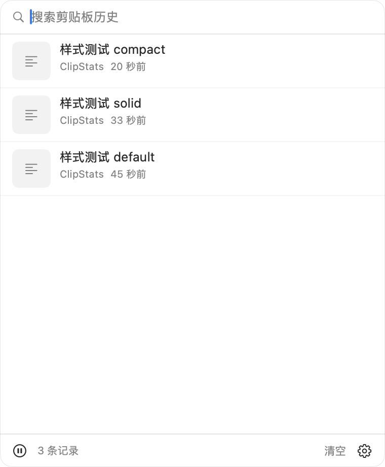

# ClipStats

macOS 菜单栏系统监控 + 剪贴板历史工具（Apple Silicon / arm64 原生，Swift + AppKit/SwiftUI）。

菜单栏实时显示 CPU、GPU、内存、温度、网速，并可拉出剪贴板历史列表；点击任意历史条目会把它放回系统剪贴板，之后按 ⌘V 即可粘贴。


纯色 / 毛玻璃背景：

| 纯色 | 毛玻璃 |
| --- | --- |
|  |  |

| 剪贴板面板 | 设置 · 外观 |
| --- | --- |
|  |  |

## 不需要 Xcode

本工程使用 `swiftc` + `Makefile` 直接编译并手工组装 `.app`，只需要 **Command Line Tools**：

```bash
xcode-select --install      # 已安装可跳过
swift --version             # 应输出 Swift 6.x
```

> 注意：新版 macOS 的 SwiftUI 中 `@State` 依赖仅随 Xcode 分发的宏插件。本项目因此采用
> 「模型驱动」写法（`ObservableObject` + `@ObservedObject`/`@Binding`），完全不需要 Xcode。

## 构建

```bash
make build     # 只编译二进制到 build/ClipStats
make bundle    # 组装 build/ClipStats.app 并 ad-hoc 签名
make run       # 重新构建、打包并启动（开发用）
make install   # 安装到 /Applications 并启动
make clean     # 清理
```

## 功能

### 状态栏
- 模块：CPU 占用、GPU 占用、内存、温度、网速、剪贴板条目数
- 每个模块可独立开关、选择是否显示图标 / 数值，并可拖拽或上下箭头排序
- **固定宽度**：每个模块按最长数值预留槽位，菜单栏宽度不会随温度/网速跳动而抖动（可关闭）
- **外观可调**：字号、图标大小、列间距、左右边距、数值对齐（居中/靠右）、纯色或毛玻璃背景、
  自定义字体颜色
- 左右点击行为：左键打开剪贴板面板，右键弹出菜单（历史 / 暂停记录 / 清空 / 设置 / 退出）
- 字号、温度取值方式（平均值 / 最高值）可调

### 剪贴板历史
- 自动记录复制过的 **文本、图片、文件**
- 支持搜索、单条删除、清空全部、暂停记录
- 点击条目 → 内容回到系统剪贴板（顶部），随后按 ⌘V 粘贴
- 相同内容再次复制不会产生重复条目，只会提到列表顶部
- 默认跳过带 `org.nspasteboard.ConcealedType` 标记的内容（1Password 等密码管理器）
- 数据保存在 `~/Library/Application Support/ClipStats/clipboard.db`（SQLite，WAL）

### 设置窗口
六个页签：状态栏（模块与排序）、外观（尺寸间距、背景、字体颜色）、刷新频率、剪贴板、快捷键、关于。

外观页支持：

| 项目 | 说明 |
| --- | --- |
| 字号 / 图标大小 | 10–16pt / 8–18pt |
| 列间距 / 左右边距 | 0–20pt，觉得太宽就调小 |
| 数值对齐 | 居中或靠右（固定槽位内） |
| 背景 | 无 / 纯色（自选颜色 + 不透明度）/ 毛玻璃 |
| 字体颜色 | 跟随系统，或自定义 |
快捷键基于 Carbon `RegisterEventHotKey`，**不需要辅助功能权限**。

## 数据来源

| 指标 | 实现 |
| --- | --- |
| CPU | `host_statistics(HOST_CPU_LOAD_INFO)` + `host_processor_info`（差分） |
| GPU | IORegistry `IOAccelerator` → `PerformanceStatistics` → `Device Utilization %` |
| 内存 | `host_statistics64(HOST_VM_INFO64)`、`sysctl vm.swapusage` |
| 网速 | `sysctl(NET_RT_IFLIST2)` → `if_msghdr2` 的 64 位收发字节数差分 |
| 温度 | IOKit `AppleSMC` 用户客户端（非 root，启动时自动枚举全部温度键） |

温度采用**运行时动态枚举**而非硬编码键表：不同芯片 / 系统版本的 SMC 键名并不一致
（例如本机 macOS 27 + M1 上并不存在常见 M1 键表中的 `Tp01`/`Tg05`，实际是 `Tp2x…Tp9z` 等）。
所有读取都做了失败降级：读不到就显示 `--`，不会崩溃。

## 开源许可

本项目以 **MIT** 许可证发布，见 [LICENSE](LICENSE)。

系统指标读取部分参考了 [Stats](https://github.com/exelban/stats)（MIT，Copyright © 2019 Serhiy Mytrovtsiy），
派生范围与上游许可证原文见 [THIRD_PARTY_NOTICES.md](THIRD_PARTY_NOTICES.md)。MIT 允许自由使用、
修改、再分发乃至商用，只需保留版权与许可声明 —— 因此本项目在发布时保留上述声明即可。

## 已知限制

- **GPU 温度**：部分机型（含本机 M1）不暴露 GPU 温度键，此时只显示占用率。
- **自动粘贴**：默认只把内容放回剪贴板，需要你自己按 ⌘V；若做「点击即粘贴」则需授予辅助功能权限。
- **签名**：ad-hoc 签名（`codesign -s -`），仅本机自用；换机器或重新编译后系统权限（如未来的辅助功能）需要重新授权。
- **开机自启**：建议 `make install` 后再开启，否则登录项指向 `build/` 下的临时路径。

## 开发用自检开关

```bash
CLIPSTATS_DIAG=1 ./build/ClipStats                     # 每 2 秒输出一次指标日志，并校验栏宽是否稳定
CLIPSTATS_DIAG_SHOW=panel ./build/ClipStats            # 启动后自动弹出剪贴板面板
CLIPSTATS_DIAG_SHOW=snapshot ./build/ClipStats         # 离屏渲染界面截图到 /tmp/shot-*.png
CLIPSTATS_DIAG_TABS=1 ...                              # 额外输出每个设置页截图
CLIPSTATS_DIAG_RESTORE=12 ./build/ClipStats            # 自动把 id=12 的条目写回剪贴板
CLIPSTATS_DIAG_APPEARANCE=solid ./build/ClipStats      # 预览外观：solid / glass / compact
CLIPSTATS_DATA_DIR=/tmp/clipdata ./build/ClipStats     # 使用独立数据目录（隔离测试）
```
