<div align="center">

<p align="right">
  <b>简体中文</b> &nbsp;｜&nbsp; <a href="README_EN.md">English Document</a>
</p>

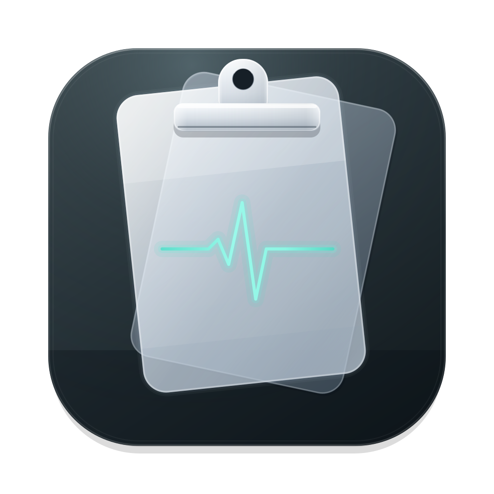

# 🚀 ClipStats

**极致轻量、原汁原味的 macOS 菜单栏系统监控、原生剪贴板管家与随身英汉小翻译**  
*The Ultra-Lightweight, Native macOS Menu Bar System Monitor & Privacy-First Clipboard Manager.*

[](https://www.apple.com/macos/)
[%20%7C%20Intel-007AFF?style=flat-square)](https://github.com/sagirilovely/ClipStats/releases)
[-F05138?style=flat-square&logo=swift&logoColor=white)](https://swift.org)
[](https://developer.apple.com/design/)
[](LICENSE)

<br />


<br />
<sub>✨ Apple 液态玻璃拟物光泽 & 格式塔紧凑布局 状态栏实测展示</sub>

<br />

[✨ 核心亮点](#features) &nbsp;•&nbsp; 
[📊 竞品横评](#comparison) &nbsp;•&nbsp; 
[🖼 视觉展示](#showcase) &nbsp;•&nbsp; 
[📦 下载安装](#download) &nbsp;•&nbsp; 
[🛠 架构解析](#architecture) &nbsp;•&nbsp; 
[❓ 常见问题](#faq)

</div>

---

## <a id="why"></a>💡 为什么选择 ClipStats？

在日常使用 macOS 时，很多开发者与重度用户往往面临两个痛点：
1. **菜单栏过于臃肿**：既要开启系统监控（如 Stats / iStat Menus），又要运行剪贴板工具（如 Maccy / Paste），再加上其他常驻图标，菜单栏空间捉襟见肘，在 MacBook 的刘海屏下甚至被强制遮挡。
2. **后台开销与权限侵入**：很多工具动辄占用数百 MB 内存，且必须索取危险的**系统辅助功能（Accessibility）**权限，存在潜在的按键记录与隐私泄露风险。

**ClipStats 的诞生，就是为了提供终极的「三合一」原生体验：**
- **合三为一，极致精巧**：将「系统性能监控」「剪贴板历史」与「英汉小翻译」深度凝结在一枚精炼的菜单栏分段中，状态栏宽度压榨至仅 **269pt**。
- **苹果液态玻璃（Liquid Glass）视觉**：macOS 26 起，剪贴板 / 进程 / 翻译浮窗直接调用系统 `.glassEffect`（真实折射、边缘高光与焦点感知），设置窗口使用系统玻璃底 + 轻遮罩；菜单栏胶囊则完全自绘（菜单栏本身已是玻璃层，再嵌系统玻璃只会采样到自己），按系统规范对齐 20pt 胶囊 / 半高圆角 / 内侧 hairline 高光。旧系统自动回落到 `NSVisualEffectView` 组合，开启「降低透明度」时一律退回不透明底。
- **独立分段悬停与进程分类面板**：鼠标悬停在 CPU / GPU / 内存 / 网络上独立亮起高光，点击即可直达对应的分类运行进程列表并支持一键终止高耗能进程。
- **自带离线英汉小翻译**：剪贴板与进程面板底栏各有一枚 `A文` 按钮，随手点开就能「填一侧、翻另一侧」，写变量名时不必再切到浏览器或翻译 App，推理全程在本机完成。
- **零辅助功能权限 & 极致私密**：依托底层 Carbon 全局热键与系统 pasteboard changeCount 监听，无需任何辅助功能权限；剪贴板数据采用 SQLite3 WAL 模式本地密存，内容绝不外传。
- **极速构建与超低占用**：纯原生 Swift 编写，**无需安装数十 GB 的 Xcode**，命令行几秒即可编译完成。常驻内存 **< 25MB**，CPU 负载长期维持在 **0.5% 以下**。

---

## <a id="comparison"></a>📊 产品横评与选型对比

| 对比维度 | **ClipStats (本项目)** | **Stats** | **Maccy** | **iStat Menus** | **Paste** |
| :--- | :---: | :---: | :---: | :---: | :---: |
| **产品定位** | **监控 + 剪贴板 + 小翻译 三合一** | 仅系统监控 | 仅剪贴板历史 | 仅系统监控 | 仅剪贴板历史 |
| **设计风格** | **Apple 液态玻璃 (Liquid Glass)** | 简约扁平 | 原生菜单项 | 传统拟物 | 底部卡片浮窗 |
| **刘海屏优化** | **极度紧凑 (间距 5–20pt / 内边距 0–20pt 微调)** | 较占空间 | 不显示监控 | 较占空间 | 不显示监控 |
| **辅助功能权限 (AX)** | **❌ 零权限要求 (更安全)** | ❌ 不需要 | ⚠️ 需要辅助功能 | ⚠️ 需要辅助功能 | ⚠️ 需要辅助功能 |
| **常驻内存开销** | **约 18–25 MB** | 约 60–120 MB | 约 30–50 MB | 约 100–250 MB | 约 80–180 MB |
| **Apple Silicon SMC 温度** | **✅ 运行时动态自适应枚举** | ✅ 支持 | — | ✅ 支持 | — |
| **运行进程列表与管理** | **✅ 实时 CPU/GPU/内存/网络排序 + 释放** | ✅ 支持 | — | ✅ 支持 | — |
| **网速垂直双行布局** | **✅ 支持 (节约 50% 宽度)** | ✅ 支持 | — | ✅ 支持 | — |
| **内置英汉速查翻译** | **✅ 系统离线翻译 (macOS 15+)** | — | — | — | — |
| **免 Xcode 快速构建** | **✅ 纯命令行 (Makefile + swiftc)** | ⚠️ 依赖 Xcode | ⚠️ 依赖 Xcode | ❌ 闭源商业软件 | ❌ 闭源商业软件 |
| **开源免费与隐私** | **✅ 100% MIT 开源，零遥测（仅查版本号）** | ✅ MIT 开源 | ✅ MIT 开源 | ❌ 付费订阅 | ❌ 付费订阅 |

---

## <a id="features"></a>✨ 核心特性

### 1. 🎛 灵动精准的菜单栏监控 (System Monitor)
- **六维核心指标动态监控**：
  - **CPU 负载**：多核心用户态与系统态精确时间片滴答差分计算。
  - **GPU 占用**：IOAccelerator 硬件加速器实时利用率，兼顾 M 系列核显与 Intel 平台。
  - **物理内存**：真实还原系统活动监视器标准（已用、联动 Wired、压缩 Compressed），扣除文件缓存，支持 Swap 侦测。
  - **核心硬件温度**：独家 SMC 探针动态枚举算法，自动识别 M1/M2/M3/M4 全系各异传感器键名，拒绝硬编码与崩溃。
  - **实时网络吞吐**：双 64 位字节差分采样，千兆网络不溢出；支持**上下垂直双行排布**，相较横向节省 50% 空间。
  - **剪贴板微型表盘徽章**：以 Apple Watch 复杂表盘（Complication）为灵感的拟物胶囊微章，展示当前记录总数。
- **格式塔近邻原则 (Gestalt Proximity) 间距**：
  - 标签与数值紧密锚定（2.5pt），占用率数值忠实跟随名称。
  - 排布等同 CSS 的 **`flex + gap`**：每个模块只占真实文字宽度，模块间距严格等于设置值（**5–20pt**，最小 5pt 防止相邻模块粘字），不会再出现「某个模块右侧多留一截」的空槽。
  - 左右内边距 0–20pt（不允许负值——它会把状态栏窗口顶窄导致内容被裁；开启胶囊背景时还会自动保留 3pt 圆角余量）。
- **防抖动 (Anti-Jitter)**：开启后每个模块按「最宽数值」预留一个隐藏槽位，数值在槽位内右对齐——网速从 `0B` 跳到 `1.02M`、CPU 从 `9%` 跳到 `26%`，状态栏总宽度都岿然不动；槽位余量藏在「标签↔数值」之间，不会变成模块右侧的空白。
- **多重视觉材质可选**：支持系统跟随、纯色透明度背景，以及原生**液态玻璃（Liquid Glass）**层级。

### 2. ⚡ 分段独立悬停与多模态进程面板 (Running Apps Panel)
- **独立分段悬停响应**：光标移动到哪个指标上，该模块便独立亮起柔和的液态微光；移出后恢复，提供清晰的按钮级反馈。
- **四大分类进程详情**：
  - 点击 CPU / GPU / 内存 / 网络分段，即可展开对应的分类进程面板。
  - 按当前指标（CPU / GPU / 网速 / 内存）从高到低列出**全部用户应用**，只统计 Dock 里可见的 App，不混入系统守护进程。
  - 展示应用高清图标、实际进程名称、运行时长与瞬时占用绝对值/百分比；Electron 与浏览器的辅助进程会归并回所属应用。
  - **CPU 详情卡**附带带纵坐标（100% / 50% / 0）的每核柱状图，一眼读出具体占用；**GPU 详情卡**把统一内存拆成「GPU 已用显存 / 系统其它部分已用 / 剩余」三段双色堆叠条，不会误读成「显存几乎没被占用」。
  - 网速模式下按进程归算上下行流量（来自系统 `nettop`，代理流量归属代理进程）。
  - 提供**「释放」正常退出**按钮；若应用无响应，二次确认后可强制退出，避免误杀丢数据。

### 3. 📋 原生隐私剪贴板历史 (Clipboard History)
- **全类型原生捕获**：毫秒级自动捕获纯文本、富文本（RTF/HTML）、图片（PNG/JPEG/TIFF）及文件路径列表。
- **瞬时过滤与搜索**：内置极速检索输入框与「全部 / 文本 / 图片 / 文件」四路分类标签，支持键盘上下光标秒级选定。
- **悬停即时预览**：鼠标停留 0.35 秒即在面板侧边浮出无焦点浮层——图片看原图大图、文本看内容摘录、文件看清单与文本文件前几行，不必「点一下才知道是什么」而误把旧内容塞回剪贴板。
- **一键置顶与智能去重**：常用代码片段、账号或文本一键 Pin 置顶；相同内容重复复制时自动刷新时间戳并归拢置顶，杜绝列表冗余。
- **隐私保护与密码避让**：自动侦测并跳过带有 `org.nspasteboard.ConcealedType` 与常见密码管理器（1Password、Bitwarden、KeepassXC 等）标记的敏感条目。
- **零辅助功能权限 (No Accessibility Permissions)**：基于 macOS 底层 Carbon `RegisterEventHotKey`（默认快捷键 `⌥⌘V`），无需开启隐私辅助功能注入，安全无后门。

### 4. 🎨 液态玻璃美学设置系统
- **七大专属配置选项卡**：状态栏模块、外观调节、刷新频率、剪贴板管理、全局快捷键、访达集成与关于说明。
- **液态玻璃主题切换**：支持「跟随系统 / 浅色 / 夜览」，面板配备半透明玻璃质感与镜面反射高光。
- **自动检查更新**：启动后与每 24 小时向 GitHub 查一次版本号，发现新版本弹一枚玻璃小窗（含更新说明），点「下载并安装」直接把 dmg 下到本地并挂载，拖进 Applications 即完成更新。
- **毫米级外观微调**：字体大小（9–16pt）、图标大小、左右内边距（0–20pt）与模块间距（5–20pt，最小的 5pt 仍能保证相邻模块不粘字）、数值对齐（靠左 / 居中 / 靠右）。

### 5. 🖱 访达右键增强 (Finder Menu)
- **右键直达，不用再开终端**：在访达里右键任意文件夹/文件，菜单里会多出一组 `ClipStats` 操作——**在终端中打开**、**由 X 打开**、**新建 Markdown 文件**、**新建文件…**。
- **自动识别 40+ 编辑器**：Cursor、Trae（含 CN 版）、CodeBuddy（含 CN 版）、Windsurf、Antigravity、Qoder、ZCode、WebStorm、CLion、IntelliJ IDEA、PyCharm、GoLand、PhpStorm、Rider、DataGrip、Xcode、Android Studio、VS Code / VSCodium、Zed、Sublime Text、Nova、Emacs、MacVim…**装了哪个就列哪个**，标题统一「由 X 打开」，不用再去翻又慢又长的「打开方式」。
- **新建文件面板**：可选目标路径、六种类型（Markdown / 文本 / JSON / Python / Shell / 自定义后缀），底部实时预览最终文件名；JSON 自动写入 `{}`，Python / Shell 自动带 shebang 与 `755` 可执行位；重名自动递增（`未命名 2.md`），绝不覆盖。
- **沙盒内只读、落盘交给主程序**：访达扩展受系统强制沙盒限制，只读取路径；所有写操作由常驻的 ClipStats 主程序执行。因此**不会弹访达窗口、不抢焦点**，结果用右上角的轻量 HUD 提示（`已新建：未命名.md`）。
- **首次启用有引导**：设置里新增「集成」页，可一键检测扩展状态、打开系统设置、重新加载访达；macOS 15 移除了扩展开关，内置 `pluginkit` 一键启用与命令兜底。

### 6. 🔤 随身英汉小翻译 (Mini Translator)
- **随处可唤，不打断心流**：剪贴板面板与进程面板底栏各有一枚 `A文` 按钮，点开即是一枚 344pt 的迷你浮窗，鼠标始终不必离开菜单栏。
- **双向即时互译**：左右两个输入框，**填哪一侧就自动翻译另一侧**（停顿 0.35 秒触发）；含汉字自动判为「中 → 英」，否则「英 → 中」，顶部胶囊实时显示当前方向。
- **为变量名而生**：`userName` → 用户名、主要按钮 → `Main button`，译文可直接 ⌘C 带走，省去在浏览器标签页之间来回切换的心智负担。
- **系统原生离线推理**：调用 macOS 15 起的 Apple `Translation` 框架（`TranslationSession` + SwiftUI `.translationTask`），语言模型在本机运行，**零 API Key、零第三方服务、零网络请求**。
- **失败可见，而不是无声转圈**：语言包未安装时直接给出「去设置 / 重试」，6 秒无响应即报超时；浮窗不进 Dock、不抢焦点，`ESC` 或 `✕` 即刻收起。

---

## <a id="showcase"></a>🖼 界面与视觉展示

### 状态栏细节与交互体验

| 状态栏默认态（液态玻璃胶囊徽章） | 状态栏分段悬停态（独立发光） |
| :---: | :---: |
|  |  |
| <sub>紧凑近邻排版，格式塔亲密性优化，宽度仅 269pt</sub> | <sub>光标悬停在 CPU 分段，CPU 独立高亮，徽章保持激活</sub> |

| 网速垂直双行（节约横向空间） | 经典纯色背景模式 |
| :---: | :---: |
|  |  |

---

### 功能面板展示

| 进程详情面板（点击状态栏指标呼出） | 原生剪贴板面板（默认快捷键 `⌥⌘V`） |
| :---: | :---: |
| 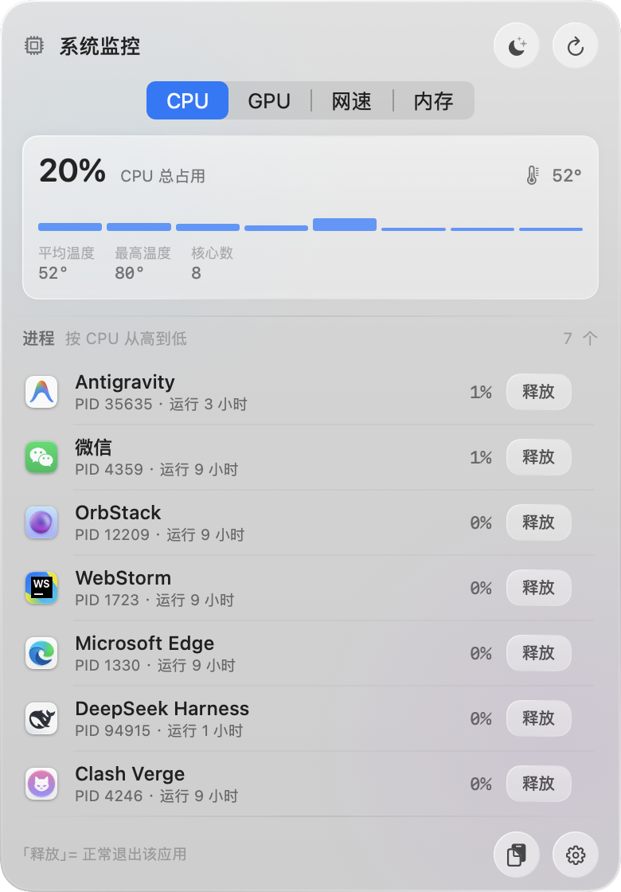 | 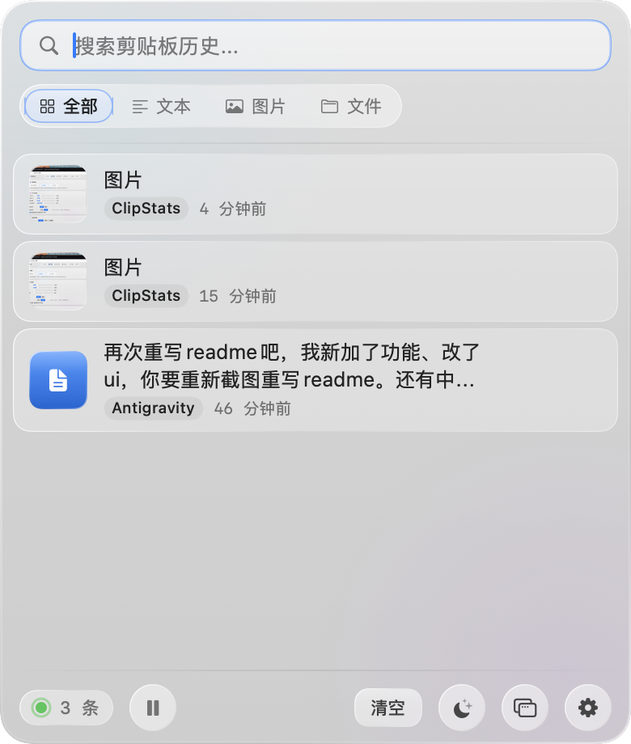 |
| <sub>按当前指标排序全部用户应用，CPU 每核柱状图带纵坐标，GPU 显示显存已用/总</sub> | <sub>文本/图片/文件秒级检索，分类过滤，一键置顶与安全复制</sub> |

| 悬停预览：图片直接看原图 | 悬停预览：文本内容摘录 | 悬停预览：文件清单 |
| :---: | :---: | :---: |
| 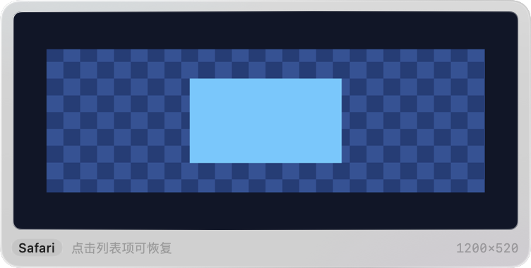 | 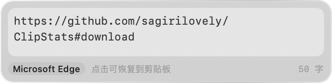 | 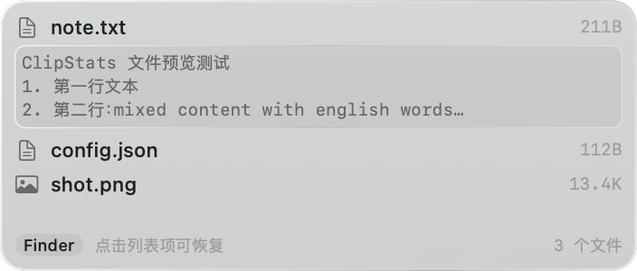 |
| <sub>原图按比例缩到 360pt 内，标注真实像素尺寸</sub> | <sub>高度按真实字体测量，长文本以省略号收尾</sub> | <sub>文本文件显示前几行；图片、PDF 只显示文件信息</sub> |

---

### 英汉小翻译

| 两个面板底栏的 `A文` 入口 | 双向即时互译（填一侧，另一侧自动出） |
| :---: | :---: |
| 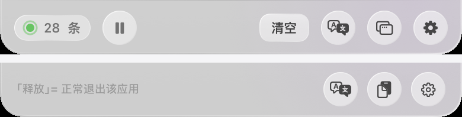 | 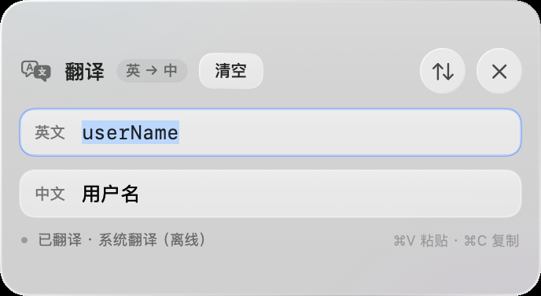 |
| <sub>剪贴板面板与进程面板底栏均可一键呼出，主题切换仍在进程面板右上角与设置里</sub> | <sub>自动识别中英方向，<code>userName</code> → 用户名、主要按钮 → <code>Main button</code></sub> |

---

### 液态玻璃配置系统

| 外观与紧凑间距定制 | 状态栏模块拖拽排序 |
| :---: | :---: |
| 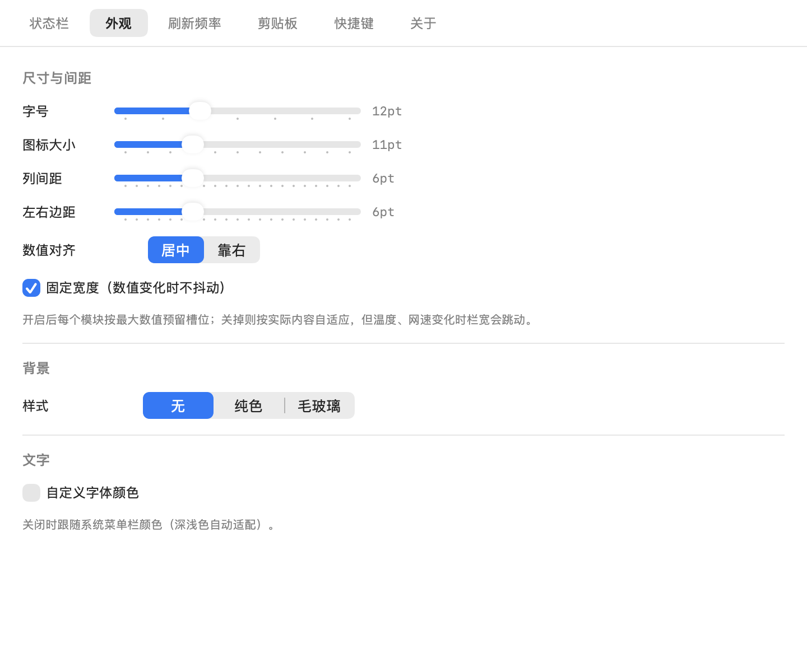 | 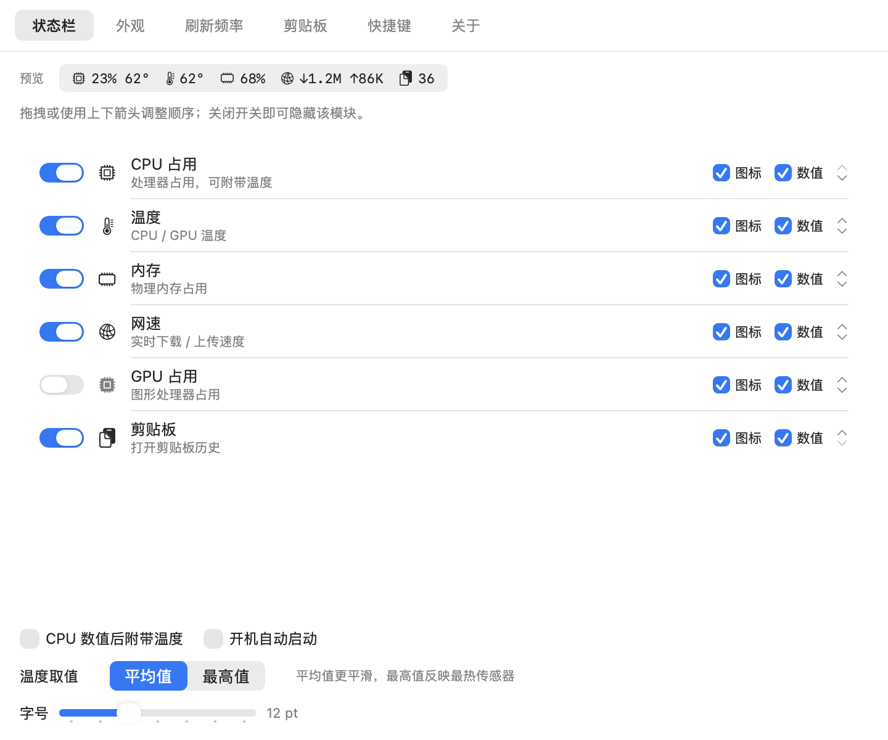 |
| <sub>模块间距（5–20pt）/ 左右内边距微调，间距严格等宽，彻底消除刘海屏拥挤</sub> | <sub>六大指标自由启闭，支持图标/文本/隐藏前缀切换</sub> |

| 剪贴板历史容量与隐私选项 | 快速键个性化绑定 |
| :---: | :---: |
|  | 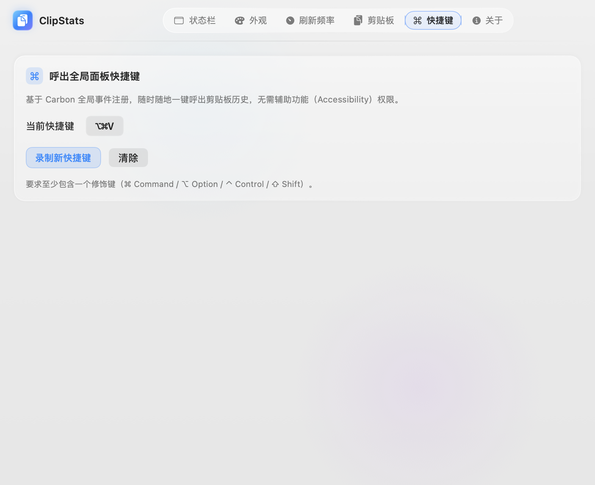 |

---

### 访达右键增强

| 右键菜单：终端 / 编辑器 / 新建文件 | 新建文件面板：路径、类型与实时预览 |
| :---: | :---: |
| 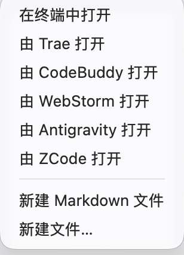 | 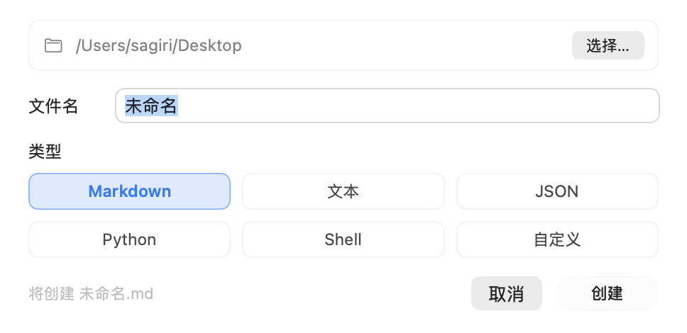 |
| <sub>装了哪个 IDE 就列哪个「由 X 打开」，创建类收在分隔线下方</sub> | <sub>六种类型 + 自定义后缀，底部预览「将创建 xxx.md」，重名自动递增</sub> |

| 设置 › 集成：扩展状态与一键启用 |
| :---: |
|  |
| <sub>扩展是否启用、打开系统设置、重新检测、重新加载访达，以及桌面/文稿/下载的授权引导</sub> |

---

## <a id="download"></a>📦 下载与安装

### 方式一：下载预编译发布包 (推荐)
前往 [GitHub Releases](https://github.com/sagirilovely/ClipStats/releases) 获取最新发布产物：
- `ClipStats-<version>-macos-universal.zip` —— 通用架构（Apple Silicon + Intel）归档，解压即可运行。
- `ClipStats-<version>-macos-universal.dmg` —— 官方拖拽安装镜像。

装好之后 ClipStats 会在启动 8 秒后、以及每 24 小时自查一次新版本；发现更新会弹出一枚玻璃小窗（含更新说明），点「下载并安装」即把 dmg 下到本地并自动挂载，覆盖安装即可完成升级。该检查可在「设置 › 关于 › 软件更新」关闭。

> [!TIP]
> **首次运行遇到「已损坏」或「无法打开」提示？**  
> 本项目为开源软件，使用 Ad-hoc 方式自签名。若 macOS 系统的 Gatekeeper 阻止运行，您只需：
> 1. 在 Finder 中**右键点击 ClipStats.app → 选择“打开”**，并在弹出的确认框中点击“打开”；
> 2. 或在终端运行以下命令移除隔离标记：
>    ```bash
>    xattr -dr com.apple.quarantine /Applications/ClipStats.app
>    ```

### 装好之后：启用访达扩展（重要）

右键菜单依赖系统的 **访达扩展**，首次使用需要手动启用一次：

1. 打开 ClipStats → **设置 › 集成**，确认「访达右键扩展」的状态；
2. 点「打开系统设置…」，在 **通用 › 登录项与扩展 › 访达扩展** 里勾选 **ClipStats 扩展**；
3. 回到设置点「重新检测」，状态变绿即生效；如果菜单没出现，点一下「重新加载访达」。

> [!NOTE]
> - **macOS 15（Sequoia）** 移除了访达扩展的图形开关，请直接点设置页里的「启用扩展」按钮（App 会自动调用 `pluginkit`）；失败时可复制页面上的命令到终端执行。macOS 26 起开关已恢复。
> - 首次在**桌面 / 文稿 / 下载**目录新建文件时，系统会弹一次「ClipStats 想访问…」的授权，允许即可；也可以先在设置页点「授权桌面 / 文稿 / 下载」提前完成。
> - 请务必先把 App 放进 `/Applications` 再启用扩展：从 DMG 里直接运行会触发 App Translocation，扩展会注册在临时路径上。

---

### 方式二：从源码极速构建安装（无需 Xcode）
很多开发者不愿为了编译一个几兆的菜单栏应用而下载安装 40GB+ 的 Xcode。ClipStats 采用极简透明的纯 Swift 编译器工作流，**只要系统有 Command Line Tools（约 200MB）即可在十几秒内完成编译**：

```bash
# 1. 检查并安装 macOS 命令行编译套件（如已安装可跳过）
xcode-select --install

# 2. 克隆仓库
git clone https://github.com/sagirilovely/ClipStats.git
cd ClipStats

# 3. 编译并直接安装到 /Applications
make install
```

#### 常见 Makefile 指令：
```bash
make build        # 快速编译二进制产物到 build/ClipStats
make bundle       # 组装 ClipStats.app 应用程序包并完成 Ad-hoc 本地签名
make run          # 一键编译、组装并直接拉起运行（前台开发热重载）
make install      # 安装到系统 /Applications 目录并提示是否替换
make package      # 构建生产级 Universal 架构分发包 (dist/*.zip)
make clean        # 清理 build 临时目标与 Swift 模块缓存
```

---

## <a id="architecture"></a>🛠 技术实现与底层架构

ClipStats 严格遵从原生 Apple 工业级架构标准，全工程使用 **纯 Swift + AppKit + SwiftUI + 系统 C 语言底层 API**，不依赖任何第三方 Pod、Carthage 或大型 SPM 依赖。

### 架构全景设计

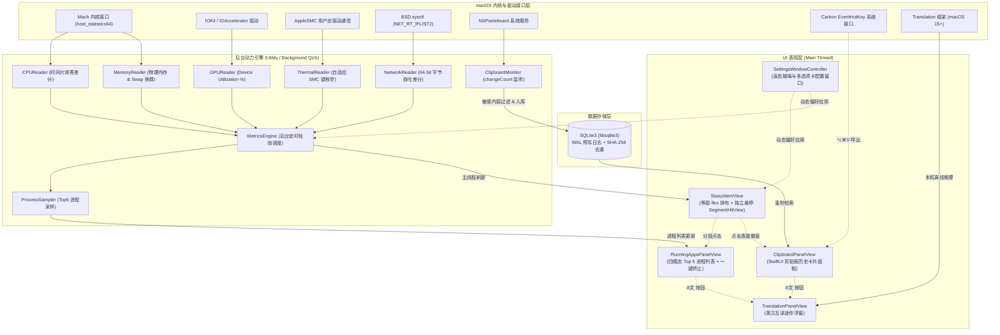

---

### 内核指标采集机制说明

| 监控指标 | 底层调用 API | 性能与稳定性考量 |
| :--- | :--- | :--- |
| **CPU 负载** | `host_statistics(mach_host_self(), HOST_CPU_LOAD_INFO, ...)` | 统计 `user`、`system`、`idle`、`nice` 时间片滴答计数差分；避免 fork 子进程。 |
| **GPU 占用** | IORegistry `IOAccelerator` → `PerformanceStatistics` | 读取显卡加速器 `Device Utilization %`，兼容 Apple Silicon 统一内存核显与 Intel 核显。 |
| **物理内存** | `host_statistics64(HOST_VM_INFO64)` + `sysctl("vm.swapusage")` | 精准获取活跃、联动（Wired）、压缩内存（Compressed），剔除文件缓存，与系统活动监视器一致。 |
| **实时网速** | `sysctl(NET_RT_IFLIST2)` 解析 `if_msghdr2` | 遍历网络接口的 64 位 `ifi_ibytes` / `ifi_obytes`。采样周期算差分，支持高并发千兆网络不溢出。 |
| **芯片温度** | IOKit `AppleSMC` 用户态通道 (`IOServiceOpen`) | **创新型动态自适应扫描枚举**：启动时自动探测 M 系列芯片多达数十种温控键，彻底摆脱写死键名造成的读取失败。 |
| **运行进程** | `libproc` (`proc_listpids`, `proc_pidinfo`) | 高效遍历系统活跃进程与内存/CPU消耗，使用 `NSRunningApplication` 提取 Retina 图标。 |

---

### 英汉小翻译的实现要点

| 环节 | 做法 | 设计考量 |
| :--- | :--- | :--- |
| **方向判定** | 扫描 Unicode 区间（`0x4E00–0x9FFF` 等汉字与假名） | 命中即「中 → 英」，否则「英 → 中」；变量名场景默认英文，无需手动切方向。 |
| **翻译调用** | `TranslationSession.Configuration` + SwiftUI `.translationTask` | 配置变更时回调 session，先 `prepareTranslation()` 处理语言包，再 `translate(_:)` 取译文，模型全程在本机推理。 |
| **宿主视图** | 1×1 的 `TranslationTaskHost` 塞进面板背景 | `.translationTask` 要求视图真实挂在窗口里，纯后台对象收不到回调；用 1pt 透明视图既满足要求又不影响布局。 |
| **失败兜底** | 语言包状态预检 + 6 秒看门狗 | 系统在语言包缺失时会静默挂起回调，看门狗把「永远转圈」变成可行动提示（去设置 / 重试）。 |
| **依赖边界** | 仅 Apple `Translation` 框架 | 零 API Key、零第三方 SDK、零网络请求；macOS 13 / 14 上面板会提示需要更高系统版本，其余功能不受影响。 |

---

### 剪贴板安全与隐私保障

1. **WAL 模式 SQLite3 原生存储**
   - 直连 macOS 自带的 `libsqlite3` 动态库，无需庞大 ORM。
   - 启用 `PRAGMA journal_mode = WAL;`，写入极快且绝不阻塞 UI 渲染，关键词搜索耗时小于 1 毫秒。
2. **SHA-256 去重与存储优化**
   - 采用 Apple `CryptoKit` 对文本和图片进行 SHA-256 哈希计算，仅记录唯一快照，重复复制自动提权置顶。
3. **100% 本地数据，内容不外传**
   - 数据库存储在本地沙盒目录 `~/Library/Application Support/ClipStats/clipboard.db`，项目无任何网络请求代码，支持离线绝对隔离；英汉翻译同样只调用系统框架在本机推理。
4. **唯一的网络请求：检查更新**
   - 启动后与每 24 小时向 GitHub 查询一次最新版本号（`releases/latest`），**只读取版本号、安装包地址与更新说明**，不上传剪贴板内容、设备标识或任何使用数据。
   - 该请求可在「设置 › 关于 › 软件更新」中随时关闭；手动点击「检查更新」才会立即发起。除此之外项目没有任何其他网络请求代码。
5. **零辅助功能权限热键**
   - 依托 Carbon 底层 `RegisterEventHotKey` 机制，不需要用户授予 Accessibility 权限，避免恶意代码监听击键。

---

## <a id="diagnostics"></a>🩺 本地开发与诊断指令

ClipStats 包含强大的诊断与热调试环境变量，可在终端直接执行各种调试与截图功能：

```bash
# 1. 开启指标详细采集日志与菜单栏抖动校验
CLIPSTATS_DIAG=1 ./build/ClipStats.app/Contents/MacOS/ClipStats

# 2. 模拟鼠标悬停并自动离屏生成状态栏与面板全量截图（存入 /tmp/shot-*.png）
CLIPSTATS_DIAG=1 CLIPSTATS_DIAG_SHOW=snapshot ./build/ClipStats.app/Contents/MacOS/ClipStats

# 3. 直接唤起 CPU 模式运行进程面板进行调试
CLIPSTATS_DIAG=1 CLIPSTATS_DIAG_SHOW=apps CLIPSTATS_DIAG_APPS_MODE=cpu ./build/ClipStats.app/Contents/MacOS/ClipStats

# 4. 指定独立的测试数据目录（避免污染生产剪贴板记录）
CLIPSTATS_DATA_DIR=/tmp/clipstats-dev ./build/ClipStats.app/Contents/MacOS/ClipStats

# 5. 走真实 hover 链路验证悬停预览（image / text / files）
CLIPSTATS_DIAG=1 CLIPSTATS_DIAG_SHOW=preview CLIPSTATS_DIAG_PREVIEW_KIND=image ./build/ClipStats.app/Contents/MacOS/ClipStats

# 6. 打开英汉小翻译并跑一次真实翻译（结果与截图写入日志与 /tmp/shot-translate.png）
CLIPSTATS_DIAG=1 CLIPSTATS_DIAG_SHOW=translate CLIPSTATS_DIAG_TRANSLATE_TEXT=userName ./build/ClipStats.app/Contents/MacOS/ClipStats

# 7. 打开更新面板并检查一次（伪造旧版本 / 强制走限流兜底路径 / 指定安装包落地目录）
CLIPSTATS_FAKE_VERSION=1.0.0 CLIPSTATS_DIAG=1 CLIPSTATS_DIAG_SHOW=update ./build/ClipStats.app/Contents/MacOS/ClipStats
```

---

## <a id="faq"></a>❓ 常见问题 (FAQ)

<details>
<summary><b>Q1: ClipStats 与 Stats、iStat Menus 或 Maccy 相比有何核心优势？</b></summary>
<p>
大多数用户以前必须同时运行一个系统监控软件（如 Stats）和一个剪贴板管理工具（如 Maccy）。不仅各占几十到上百兆内存，还在 MacBook 刘海屏下把菜单栏挤满。ClipStats 独创「三合一」设计，在仅 260~270pt 的极窄宽度内优雅融合了这三项能力，采用 Apple 液态玻璃拟物美学，内存占用不到 25MB，且完全不需要辅助功能权限。
</p>
</details>

<details>
<summary><b>Q2: 为什么不需要在「系统设置 - 隐私与安全性」中开启辅助功能权限？</b></summary>
<p>
传统剪贴板软件为了注册全局快捷键和注入按键粘贴（如 ⌘V），通常强制索取 Accessibility 权限。ClipStats 的呼出机制采用 macOS 底层的 Carbon EventHotKey API，该 API 是系统官方原生支持的全局热键协议，无需任何辅助功能注入权限即可安全运行。
</p>
</details>

<details>
<summary><b>Q3: 是否支持 Apple Silicon M1、M2、M3、M4 全系列芯片的温度监测？</b></summary>
<p>
完全支持！苹果在不同 M 系列芯片架构中频繁更换 SMC 温度传感器键名。ClipStats 自带动态传感器枚举算法，启动时会在底层自适应扫描全部可用探针，无论基础版 M1/M2 还是最新的 M4 Pro/Max，均能精准呈现核心温度。
</p>
</details>

<details>
<summary><b>Q4: 编译此项目真的不需要下载 Xcode 吗？</b></summary>
<p>
是的！只需要 macOS 自带的 Command Line Tools（在终端执行 <code>xcode-select --install</code> 即可自动安装，体积仅 200MB 左右）。整个工程采用清晰的 Makefile 编排与模块化 swiftc 编译，十几秒即可完成 Universal 二进制打包。
</p>
</details>

<details>
<summary><b>Q6: 软件会偷偷联网吗？自动检查更新能关掉吗？</b></summary>
<p>
除了「检查更新」，ClipStats 不发任何网络请求。检查更新只做一件事：向 GitHub 的公开接口读取最新版本号、dmg 下载地址和更新说明，不上传剪贴板内容、设备标识或任何使用数据，也不需要账号。它默认开启、启动后延迟 8 秒查一次、之后每 24 小时一次；可以在「设置 › 关于 › 软件更新」里一键关闭，关闭后只有你手动点「检查更新」才会联网。发现新版本时会弹一个玻璃小窗，点「下载并安装」会把 dmg 直接下到本地并自动挂载，拖进 Applications 即完成更新。
</p>
</details>

<details>
<summary><b>Q6: 右键菜单里没有「ClipStats」，或者点了没反应？</b></summary>
<p>
先确认访达扩展已启用：<b>设置 › 集成</b> 里应当是绿色的「已启用」。若是灰的，点「打开系统设置…」在 <b>通用 › 登录项与扩展 › 访达扩展</b> 勾选 ClipStats；macOS 15 没有这个开关，直接点设置页的「启用扩展」即可（内部调用系统 <code>pluginkit</code>）。勾选后仍看不到菜单，点一下「重新加载访达」。另外，从 DMG 直接运行（没放进 /Applications）会让扩展注册到临时路径，请先把 App 拖进应用程序文件夹。
</p>
</details>

<details>
<summary><b>Q5: 英汉小翻译需要联网或付费吗？为什么第一次用时没有反应？</b></summary>
<p>
完全不需要联网，也没有任何 API Key 或额度限制——它调用的是 macOS 15 起系统自带的 Translation 框架，语言模型在本机推理。首次使用前需要在「系统设置 › 通用 › 语言与地区 › 翻译语言」里下载一次英汉语言包（约 150MB），下载完成后即可一直离线翻译。若语言包尚未下载，面板会直接提示「系统还没下载英汉语言包」并给出「去设置 / 重试」，6 秒无响应也会报告超时，绝不会让您对着一个转圈的输入框发呆。macOS 13 / 14 上该功能会提示需要更高系统版本，其余功能不受影响。
</p>
</details>

---

## <a id="license"></a>📄 开源协议与鸣谢

- 本项目采用 **[MIT License](LICENSE)** 开源协议，欢迎自由下载、分发、二次开发或集成至个人与商业项目中。
- 底层硬件指标采集接口设计受到优秀开源项目 [Stats](https://github.com/exelban/stats)（MIT 许可，Copyright © 2019 Serhiy Mytrovtsiy）的启发，详细声明请参阅 [THIRD_PARTY_NOTICES.md](THIRD_PARTY_NOTICES.md)。
- 英汉小翻译的调用方式是参考 [Easydict](https://github.com/tisfeng/Easydict)（GPL-3.0）公开的「使用系统 Translation 框架」思路后自行实现的，**未使用其任何源代码**；本项目仍以 MIT 协议独立发布。

---

<div align="center">
  <sub>ClipStats · 让每一次复制更心安，让每一缕性能更透明</sub>
</div>
