<div align="center">

<p align="right">
  <a href="README.md">简体中文文档</a> &nbsp;｜&nbsp; <b>English Document</b>
</p>

# 🚀 ClipStats

**The Ultra-Lightweight, Native macOS Menu Bar System Monitor, Privacy-First Clipboard Manager & Offline Mini Translator**  
*Apple Liquid Glass Design · Zero Accessibility Permissions · No-Xcode Build · Apple Silicon Native*

[](https://www.apple.com/macos/)
[%20%7C%20Intel-007AFF?style=flat-square)](https://github.com/sagirilovely/ClipStats/releases)
[-F05138?style=flat-square&logo=swift&logoColor=white)](https://swift.org)
[](https://developer.apple.com/design/)
[](LICENSE)

<br />


<br />
<sub>✨ Apple Liquid Glass Translucency & Gestalt Compact Layout in Status Bar</sub>

<br />

[✨ Highlights](#features) &nbsp;•&nbsp; 
[📊 Comparison Table](#comparison) &nbsp;•&nbsp; 
[🖼 Visual Showcase](#showcase) &nbsp;•&nbsp; 
[📦 Download & Install](#download) &nbsp;•&nbsp; 
[🛠 Architecture](#architecture) &nbsp;•&nbsp; 
[❓ FAQ](#faq)

</div>

---

## <a id="why"></a>💡 Why ClipStats?

Mac power users and developers often struggle with two notorious menu bar issues:
1. **Menu Bar Crowding & Notch Clutter**: Running separate system monitors (like Stats or iStat Menus) and clipboard history tools (like Maccy or Paste) quickly eats up horizontal screen space. On modern MacBooks with camera notches, icons are frequently hidden or pushed offscreen.
2. **Resource Overhead & Privacy Risks**: Many popular utility apps consume 100MB–300MB of RAM and insist on requesting intrusive **macOS Accessibility (AX)** permissions, introducing keystroke logging risks.

**ClipStats was created to deliver the ultimate native 3-in-1 desktop companion:**
- **Compact 3-in-1 Integration**: Merges comprehensive real-time system monitoring, a robust clipboard history manager, and an on-device EN ↔ ZH mini translator into a unified menu bar item compressed down to just **269pt**.
- **Apple Liquid Glass Aesthetic**: Embraces native macOS vibrancy, specular rim reflections, ambient environmental glow, and seamless dark/light mode switching.
- **Interactive Segments & Running Apps Inspector**: Hovering over any metric lights up an isolated subtle glow; clicking on CPU, GPU, Memory, or Network pops up an instant top-process inspector with one-click termination.
- **Built-in Offline EN ↔ ZH Translator**: A tiny `A文` button in both panel footers opens a 344pt popover where typing on one side instantly fills the other — no browser tab, no translation app, and inference never leaves your Mac.
- **Zero Accessibility Permissions Required**: Leverages low-level Carbon Global HotKey APIs (`⌥⌘V`) and system pasteboard changeCount tracking. Zero invasive permissions needed.
- **Privacy-First Local Storage**: Powered by embedded SQLite3 with Write-Ahead Logging (WAL) and SHA-256 deduplication. 100% offline with zero cloud telemetry.
- **Xcode-Free Ultra-Fast Build**: Crafted in pure native Swift with no bulky SPM/CocoaPods dependencies. Compiles in seconds using standard macOS Command Line Tools. Typical resident memory is **< 25MB** with **< 0.5% CPU overhead**.

---

## <a id="comparison"></a>📊 Feature Comparison Matrix

| Feature / Metric | **ClipStats (This Project)** | **Stats** | **Maccy** | **iStat Menus** | **Paste** |
| :--- | :---: | :---: | :---: | :---: | :---: |
| **Product Purpose** | **3-in-1 (Monitor + Clipboard + Translator)** | System Monitor Only | Clipboard Only | System Monitor Only | Clipboard Only |
| **Design Language** | **Apple Liquid Glass** | Minimal Flat | Native Menu Items | Classic Skeuomorphic | Floating Card Drawer |
| **Notch-Friendly Compactness** | **Ultra-Compact (0–20pt Spacing & Padding)** | Moderate Width | N/A | Wide Footprint | N/A |
| **Accessibility Permission (AX)** | **❌ Zero Permissions Needed** | ❌ None | ⚠️ Required | ⚠️ Required | ⚠️ Required |
| **Resident Memory (RAM)** | **~18–25 MB** | ~60–120 MB | ~30–50 MB | ~100–250 MB | ~80–180 MB |
| **Apple Silicon SMC Thermals** | **✅ Dynamic Runtime Key Probing** | ✅ Supported | — | ✅ Supported | — |
| **Process Inspector & Killing** | **✅ Live CPU/GPU/RAM/Net ranking + release** | ✅ Supported | — | ✅ Supported | — |
| **Vertical Dual-Row Net Speed** | **✅ Supported (50% Space Saved)** | ✅ Supported | — | ✅ Supported | — |
| **Built-in EN ↔ ZH Translator** | **✅ On-device system translation (macOS 15+)** | — | — | — | — |
| **Xcode-Free CLI Build** | **✅ Instant (Makefile + swiftc)** | ⚠️ Requires Xcode | ⚠️ Requires Xcode | ❌ Proprietary | ❌ Proprietary |
| **Open Source & Free** | **✅ 100% MIT, Zero Telemetry** | ✅ MIT License | ✅ MIT License | ❌ Paid Subscription | ❌ Paid Subscription |

---

## <a id="features"></a>✨ Key Features

### 1. 🎛 Precision Menu Bar System Monitor
- **Six Real-Time Metric Telemetry Modules**:
  - **CPU Utilization**: Multi-core user/system tick differentials computed directly via Mach kernel hooks.
  - **GPU Utilization**: Real-time `Device Utilization %` sampled through IORegistry `IOAccelerator`.
  - **Physical Memory Pressure**: Matches Apple Activity Monitor standards (Used, Wired, Compressed), subtracting file cache; includes swap space tracking.
  - **Hardware Core Temperatures**: Dynamic SMC probe scanner dynamically discovers temperature keys across Apple Silicon M1, M2, M3, and M4 generations without hardcoded failures.
  - **Network Throughput**: 64-bit byte counters prevent integer overflow; features **vertical stacked layout** (Upload on top, Download on bottom) to save 50% horizontal menu bar space.
  - **Clipboard Complication Capsule**: Apple Watch-inspired capsule complication badge indicating stored clipboard history count.
- **Gestalt Proximity Spacing**:
  - Tight 2.5pt anchor between metric labels and numeric values.
  - Layout behaves like CSS **`flex + gap`**: every module takes exactly its text width and the gap between modules equals the slider value (**5–20pt**, 5pt minimum so neighbours never touch) — no more leftover slot padding on any module's right side.
  - Side padding 0–20pt. Negative *padding* is deliberately disallowed — it narrows the status-item window below its content and clips the bar; with a capsule background a 3pt corner margin is always kept.
- **Anti-Jitter**: the bar grows instantly when a value needs more room and only shrinks after a value has stayed narrower for a few seconds, so metrics flickering between `0%` and `100%` or `10 KB/s` and `120 MB/s` no longer pull the menu bar around.
- **Aesthetic Background Modes**: Choose between System Native, Custom Solid Tint (hex + opacity), or macOS **Liquid Glass** vibrancy.

### 2. ⚡ Interactive Segments & Multi-Mode Process Inspector
- **Independent Segment Hover & Active State**: Moving your cursor across metrics triggers an isolated soft liquid glow on that specific metric segment.
- **Categorized Running Apps Panel**:
  - Clicking CPU, GPU, Memory, or Network opens the dedicated Running Apps inspector.
  - Lists **every regular (Dock) application**, ranked by the active metric (CPU / GPU / Network / Memory); system daemons stay out of the list.
  - Displays high-resolution app icons, process names, uptime, and instantaneous load; Electron and browser helper processes are merged back into their owning app.
  - **CPU card** includes a per-core bar chart with a 100% / 50% / 0 axis; **GPU card** splits unified memory into "GPU VRAM used / other memory used / free" as a two-tone stacked bar, so it never reads as "VRAM is nearly empty".
  - Network mode attributes per-process up/down traffic (from the system `nettop`; proxied traffic is credited to the proxy process).
  - **Release (graceful quit)** button per app, with a confirmation-gated force quit as fallback, so nothing is SIGKILLed by accident.

### 3. 📋 Privacy-First Native Clipboard History
- **Multi-Type Native Capture**: Instantly records plain text, rich formatted text (RTF/HTML), raster images (PNG/JPEG/TIFF), and file path references.
- **Sub-Millisecond Search & Filter**: Real-time keyword filtering with dedicated tabs for `All`, `Text`, `Images`, and `Files`. Full keyboard navigation (`↑`/`↓` and `Enter`).
- **Hover Preview**: Rest for 0.35 s and a non-focusing overlay pops out beside the panel — full-size image, text excerpt, or a file list with the first lines of text files — so you never have to click (and overwrite the clipboard) just to see what an entry is.
- **One-Click Pinning & Smart Deduplication**: Pin frequently used snippets to stay at the top. Duplicate copies refresh existing item timestamps without bloating history.
- **Automatic Password Concealment**: Automatically ignores transient pasteboard items carrying `org.nspasteboard.ConcealedType` and markers from 1Password, Bitwarden, KeepassXC, and system Keychain.
- **Zero Accessibility Permissions**: Registered through macOS Carbon `RegisterEventHotKey` (default `⌥⌘V`), ensuring zero keylogging security exposure.

### 4. 🎨 Liquid Glass Preferences System
- **6 Focused Preference Tabs**: Status Bar Modules, Appearance, Update Intervals, Clipboard Capacity, Global Hotkeys, and About.
- **Adaptive Appearance**: Instant switching between `Follow System`, `Light`, and `Night (Dark Glass)`.
- **Pixel-Level Micro Tuning**: Fine-tune font sizes (9–16pt), icon dimensions, horizontal padding (**0–20pt**) and module spacing (**5–20pt**, the 5pt floor still keeps neighbouring segments from touching), plus numeric alignment (Left / Center / Right).

### 5. 🔤 Pocket EN ↔ ZH Mini Translator
- **One click away, no context switch**: An `A文` button sits in the footer of both the clipboard panel and the process inspector; clicking it opens a 344pt popover without ever leaving the menu bar.
- **Bidirectional instant translation**: Two fields — **whichever side you type into, the other side fills itself** after a 0.35 s pause. Text containing CJK ideographs goes 中 → 英, everything else 英 → 中, and the header pill shows the active direction.
- **Made for naming variables**: `userName` → 用户名, 主要按钮 → `Main button`; results are plain selectable text, so ⌘C is enough.
- **On-device only**: Uses Apple's `Translation` framework (macOS 15+) via `TranslationSession` and SwiftUI `.translationTask`. Models run locally — **no API key, no third-party service, no network request**.
- **Fails loudly, never spins forever**: A missing language pack surfaces "去设置 / 重试" actions, and a 6-second watchdog turns a silent stall into an actionable timeout. The popover never takes Dock space or steals focus; `ESC` or `✕` closes it.

---

## <a id="showcase"></a>🖼 Visual Showcase

### Status Bar & Interactive Feedback

| Default Status Bar (Complication Badge) | Independent Segment Hover (CPU Segment Glow) |
| :---: | :---: |
|  |  |
| <sub>Gestalt proximity alignment, compact 269pt width</sub> | <sub>Hovering over CPU illuminates only CPU; badge remains active</sub> |

| Vertical Dual-Row Network Layout | Classic Solid Tint Mode |
| :---: | :---: |
| 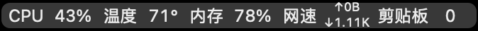 |  |

---

### Functional Panels

| Running Apps Inspector (Click any Metric) | Native Clipboard Panel (Default `⌥⌘V`) |
| :---: | :---: |
| 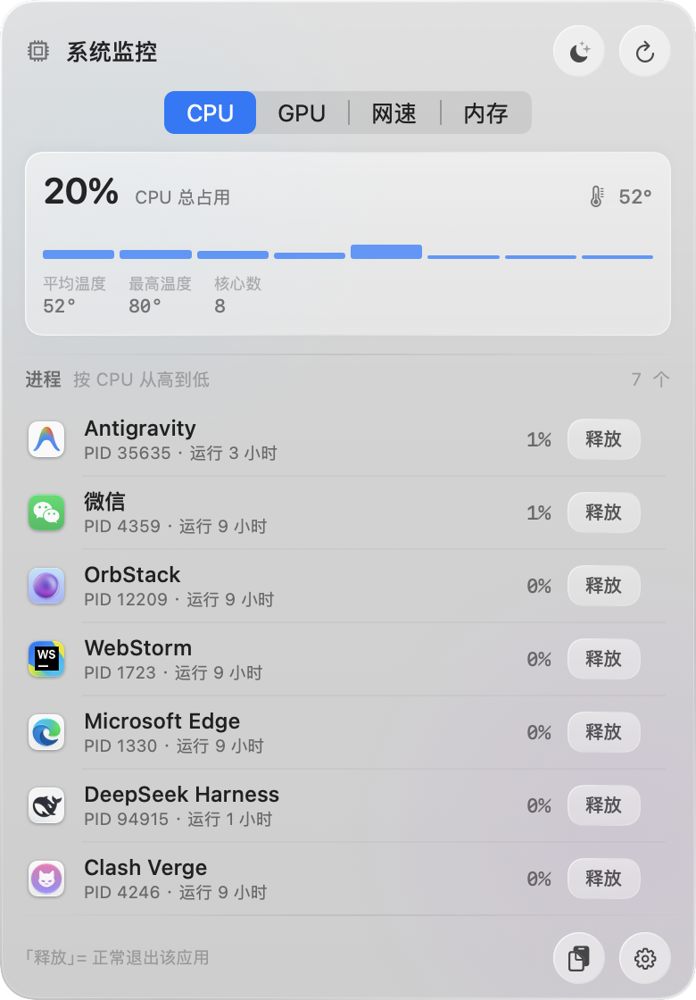 | 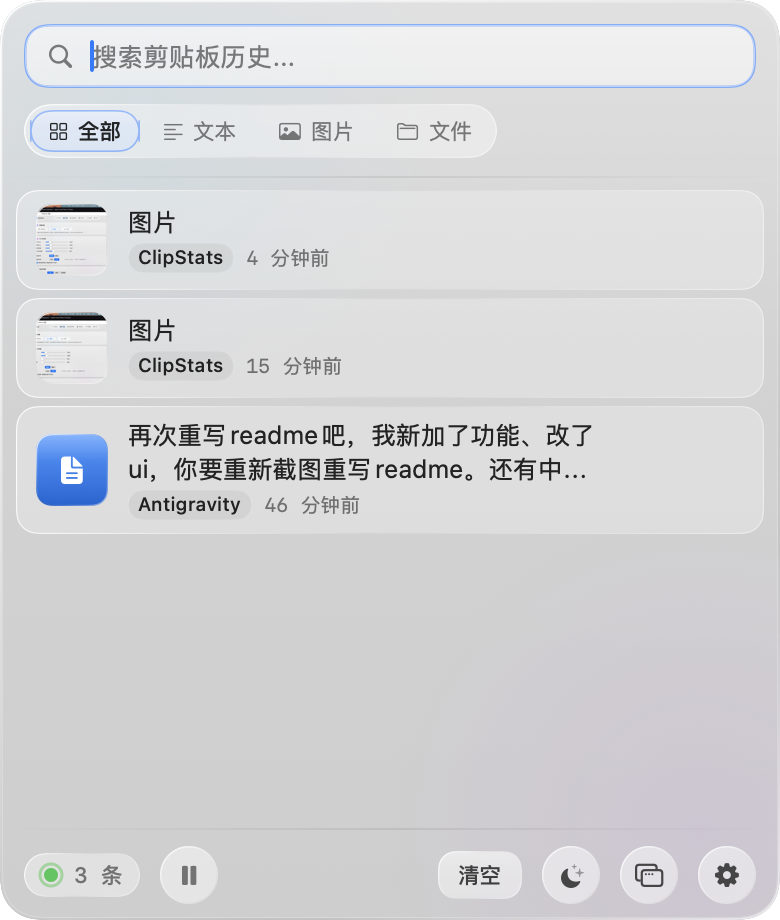 |
| <sub>All regular apps ranked by the active metric; per-core chart with axis; VRAM used/total</sub> | <sub>Sub-millisecond search, media previews, pinning, and instant restore</sub> |

| Hover Preview: Image | Hover Preview: Text | Hover Preview: Files |
| :---: | :---: | :---: |
| 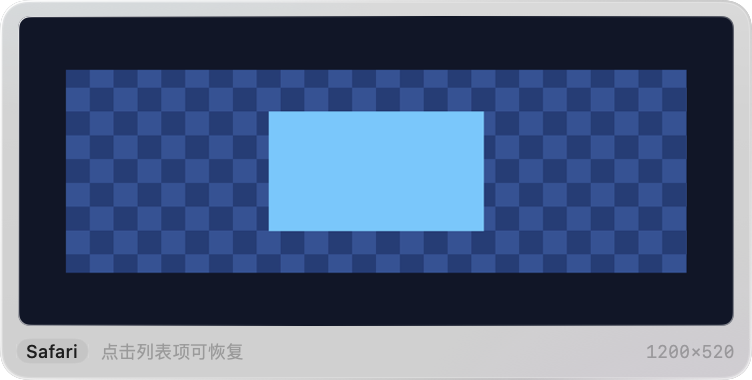 | 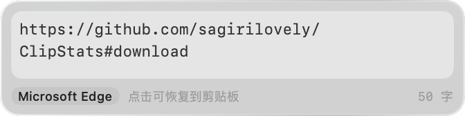 | 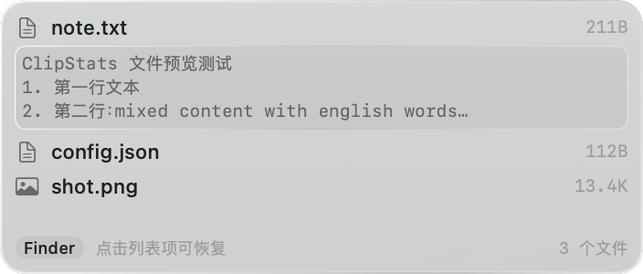 |
| <sub>Scaled to 360pt with true pixel dimensions in the caption</sub> | <sub>Height measured with the real font; long text ends in an ellipsis</sub> | <sub>Text files show their first lines; binaries show metadata only</sub> |

---

### Pocket Mini Translator

| `A文` entry in both panel footers | Bidirectional live translation (type one side, the other fills) |
| :---: | :---: |
| 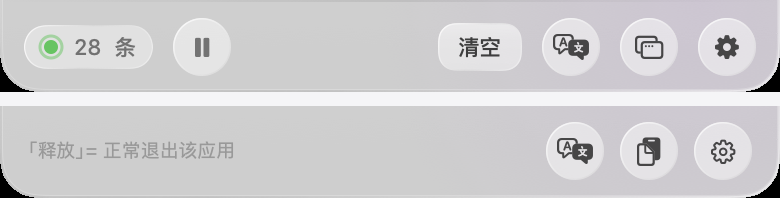 | 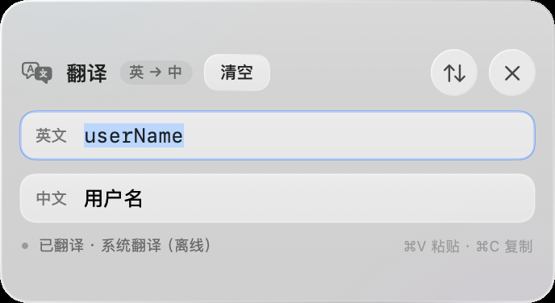 |
| <sub>Available from the clipboard panel and the process inspector; theme toggle still lives in the inspector header and Settings</sub> | <sub>Direction is detected automatically — <code>userName</code> → 用户名, 主要按钮 → <code>Main button</code></sub> |

---

### Liquid Glass Preferences

| Appearance & Notch Spacing Sliders | Status Bar Module Reordering |
| :---: | :---: |
| 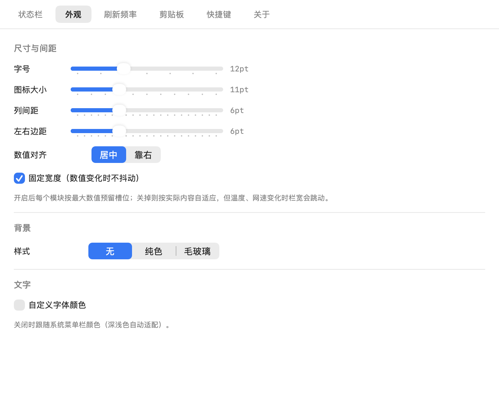 | 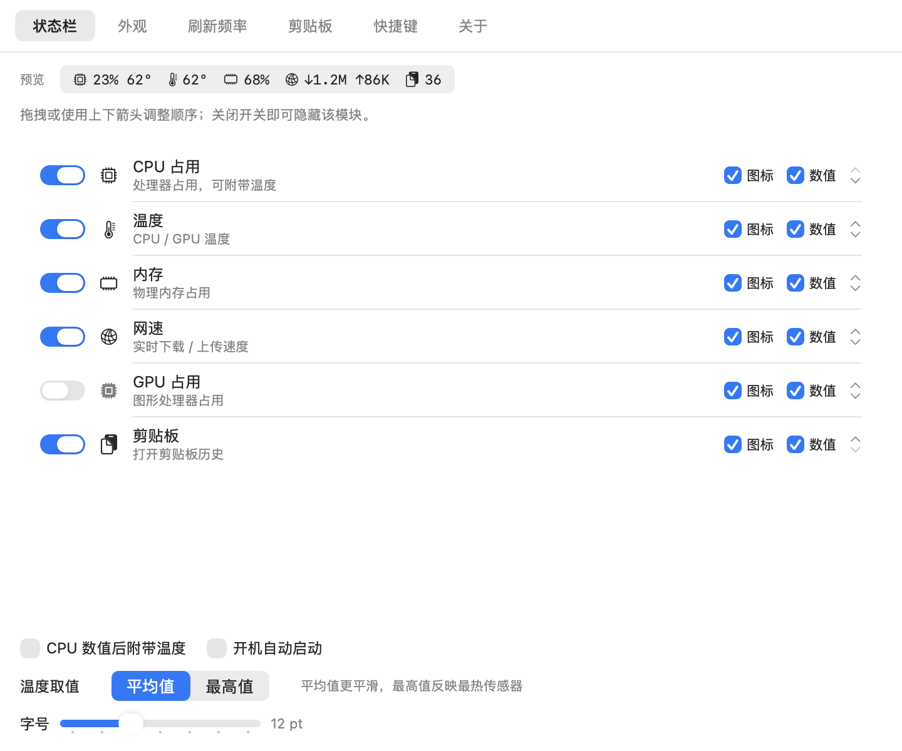 |
| <sub>Module spacing (5–20pt) and padding sliders — gaps are strictly equal, keeping the bar compact under the notch</sub> | <sub>Toggle and reorder 6 modules with icon/text prefix options</sub> |

| Clipboard History Limits & Privacy Filters | Customizable Global Hotkeys |
| :---: | :---: |
| 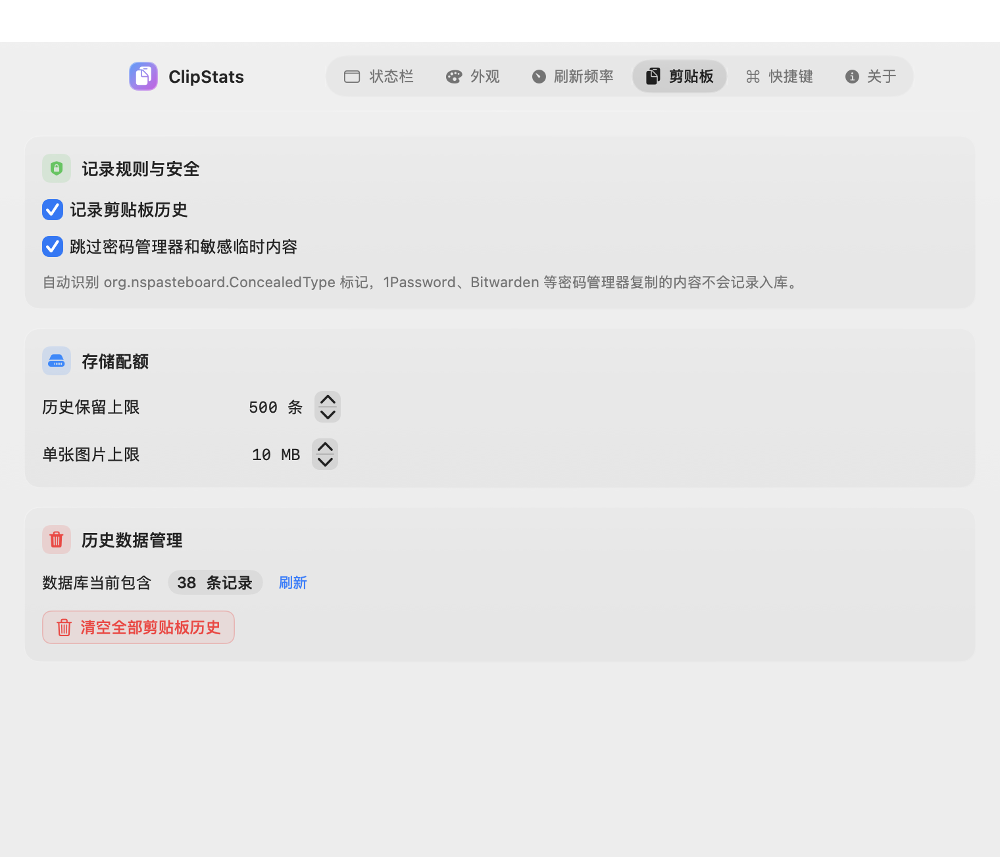 | 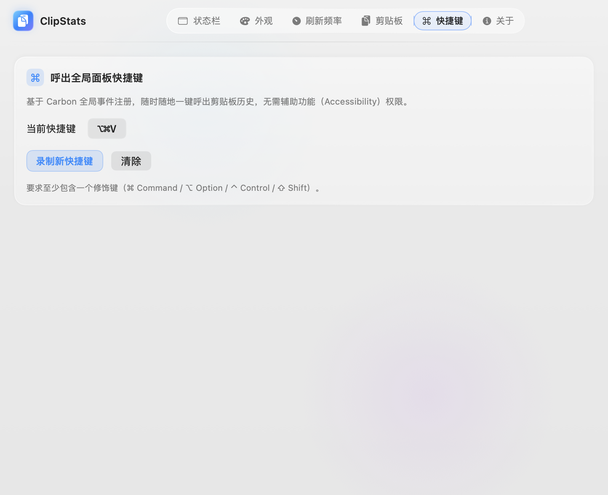 |

---

## <a id="download"></a>📦 Download & Installation

### Option 1: Pre-built Binary Release (Recommended)
Download the latest pre-compiled binaries from [GitHub Releases](https://github.com/sagirilovely/ClipStats/releases):
- `ClipStats-<version>-macos-universal.zip` —— Universal binary archive (Apple Silicon + Intel), uncompress and run.
- `ClipStats-<version>-macos-universal.dmg` —— Standard macOS drag-and-drop installer disk image.

> [!TIP]
> **First-time Gatekeeper Warning Resolution**  
> ClipStats is an open-source project signed with local Ad-hoc certificates. If macOS Gatekeeper alerts that the app cannot be opened:
> 1. In Finder, **Right-click ClipStats.app → Select "Open"**, then click "Open" on the security dialog;
> 2. Or remove the quarantine attribute in Terminal:
>    ```bash
>    xattr -dr com.apple.quarantine /Applications/ClipStats.app
>    ```

---

### Option 2: Ultra-Fast Build from Source (No Xcode Required!)
No need to download a 40GB+ Xcode installation. ClipStats compiles using standard lightweight Command Line Tools:

```bash
# 1. Install macOS Command Line Tools (skip if already installed)
xcode-select --install

# 2. Clone the repository
git clone https://github.com/sagirilovely/ClipStats.git
cd ClipStats

# 3. Build Universal app and install into /Applications
make install
```

#### Makefile Commands Cheat Sheet:
```bash
make build        # Compiles native binary to build/ClipStats
make bundle       # Packages ClipStats.app and performs Ad-hoc codesigning
make run          # Compiles, bundles, and launches the app immediately for testing
make install      # Installs ClipStats.app into /Applications
make package      # Produces release-ready Universal zip packages in dist/
make clean        # Removes build artifacts and Swift compiler caches
```

---

## <a id="architecture"></a>🛠 Technical Architecture

ClipStats is built with pure **Swift + AppKit + SwiftUI + Low-Level macOS C APIs**. It does not use heavy external package managers or bloated third-party frameworks.

### Architecture Overview

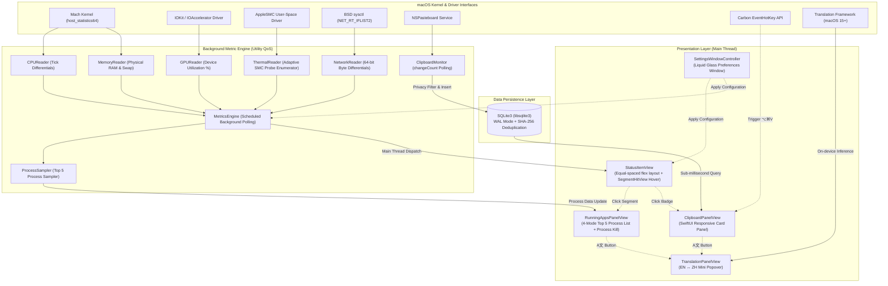

---

### Low-Level Kernel Sampling Details

| Metric | macOS Underlying API | Performance & Engineering Considerations |
| :--- | :--- | :--- |
| **CPU Load** | `host_statistics(mach_host_self(), HOST_CPU_LOAD_INFO, ...)` | Calculates delta between `user`, `system`, `idle`, and `nice` ticks. Zero shell subprocess forks. |
| **GPU Load** | IORegistry `IOAccelerator` → `PerformanceStatistics` | Reads real-time hardware `Device Utilization %` for Apple Silicon unified memory GPUs and Intel graphics. |
| **Physical RAM** | `host_statistics64(HOST_VM_INFO64)` + `sysctl("vm.swapusage")` | Computes active, wired, and compressed pages while subtracting purgeable cache to match Activity Monitor. |
| **Network Speed** | `sysctl(NET_RT_IFLIST2)` parsing `if_msghdr2` | Reads 64-bit `ifi_ibytes` / `ifi_obytes` per interface. Sampling deltas avoid counter wrapping on gigabit networks. |
| **Hardware Thermals**| IOKit `AppleSMC` connection (`IOServiceOpen`) | **Adaptive Dynamic Key Discovery**: Probes and categorizes available sensors at launch, eliminating M-series sensor key breakage. |
| **Running Apps** | `libproc` (`proc_listpids`, `proc_pidinfo`) | High-speed process sampling with `NSRunningApplication` high-res Retina icon resolution. |

---

### How the Mini Translator Works

| Stage | Approach | Engineering Consideration |
| :--- | :--- | :--- |
| **Direction detection** | Scans Unicode ranges (`0x4E00–0x9FFF` etc. for CJK ideographs and kana) | CJK input becomes 中 → 英, everything else 英 → 中; the variable-naming use case defaults to English without manual flipping. |
| **Translation call** | `TranslationSession.Configuration` + SwiftUI `.translationTask` | The task fires whenever the configuration changes; `prepareTranslation()` handles the language pack, then `translate(_:)` produces the text. Inference stays on-device. |
| **Host view** | A 1×1 `TranslationTaskHost` embedded in the popover background | `.translationTask` only fires for views genuinely attached to a window, so a bare background object is not enough; the 1pt view satisfies that without affecting layout. |
| **Failure handling** | Language-pack pre-check + 6-second watchdog | macOS silently withholds the callback when a pack is missing, so the watchdog converts an endless spinner into actionable "去设置 / 重试" actions and an explicit timeout. |
| **Dependency boundary** | Apple's `Translation` framework only | No API key, no third-party SDK, no network request. On macOS 13 / 14 the popover reports that a newer system is required; every other feature is unaffected. |

---

### Privacy & Clipboard Security

1. **WAL-Mode SQLite3 Native Engine**
   - Directly links to Apple's pre-installed `libsqlite3.dylib` without third-party ORMs.
   - Operates in `PRAGMA journal_mode = WAL;`, providing instant non-blocking reads and sub-millisecond keyword queries.
2. **SHA-256 Content Deduplication**
   - Computes SHA-256 digests via Apple's `CryptoKit` to index only unique records.
3. **100% Offline Local Storage**
   - Stored strictly in `~/Library/Application Support/ClipStats/clipboard.db`. Zero network requests, zero telemetry, zero analytics; the EN ↔ ZH translator likewise runs entirely on the system framework, locally.
4. **Zero Accessibility Permissions Required**
   - Utilizes macOS Carbon `RegisterEventHotKey` for instantaneous invocation without opening sensitive Accessibility key-logging permissions.

---

## <a id="diagnostics"></a>🩺 Diagnostic & Debug Commands

ClipStats features built-in developer diagnostic modes accessible from the command line:

```bash
# 1. Enable verbose kernel sampling logs and layout jitter detection
CLIPSTATS_DIAG=1 ./build/ClipStats.app/Contents/MacOS/ClipStats

# 2. Simulate segment hover and capture offscreen UI screenshots to /tmp/shot-*.png
CLIPSTATS_DIAG=1 CLIPSTATS_DIAG_SHOW=snapshot ./build/ClipStats.app/Contents/MacOS/ClipStats

# 3. Launch directly into the Running Apps CPU panel for inspection
CLIPSTATS_DIAG=1 CLIPSTATS_DIAG_SHOW=apps CLIPSTATS_DIAG_APPS_MODE=cpu ./build/ClipStats.app/Contents/MacOS/ClipStats

# 4. Use an isolated test database to protect production clipboard history
CLIPSTATS_DATA_DIR=/tmp/clipstats-dev ./build/ClipStats.app/Contents/MacOS/ClipStats

# 5. Exercise the real hover-preview pipeline (image / text / files)
CLIPSTATS_DIAG=1 CLIPSTATS_DIAG_SHOW=preview CLIPSTATS_DIAG_PREVIEW_KIND=image ./build/ClipStats.app/Contents/MacOS/ClipStats

# 6. Open the translator and run one real translation (log + /tmp/shot-translate.png)
CLIPSTATS_DIAG=1 CLIPSTATS_DIAG_SHOW=translate CLIPSTATS_DIAG_TRANSLATE_TEXT=userName ./build/ClipStats.app/Contents/MacOS/ClipStats
```

---

## <a id="faq"></a>❓ Frequently Asked Questions (FAQ)

<details>
<summary><b>Q1: How does ClipStats compare to running Stats alongside Maccy?</b></summary>
<p>
Previously, users had to run separate apps for system monitoring and clipboard history, wasting 150MB+ of memory and crowding the menu bar (often getting hidden under MacBook camera notches). ClipStats unifies all three capabilities in a single 269pt menu bar slot with Apple Liquid Glass styling, uses less than 25MB RAM, and requires no Accessibility permissions.
</p>
</details>

<details>
<summary><b>Q2: Why does ClipStats not ask for Accessibility permissions?</b></summary>
<p>
Many clipboard managers request Accessibility permissions to inject keystrokes and capture hotkeys. ClipStats uses the native macOS Carbon EventHotKey API for hotkeys and monitors system pasteboard change counts directly, avoiding invasive permissions entirely.
</p>
</details>

<details>
<summary><b>Q3: Are temperature sensors supported on M1, M2, M3, and M4 chips?</b></summary>
<p>
Yes! Apple changes SMC temperature sensor key names across M-series generations. ClipStats features a dynamic runtime probe discovery algorithm that scans available SMC keys upon launch, providing reliable temperature readings across base, Pro, Max, and Ultra chips.
</p>
</details>

<details>
<summary><b>Q4: Can I really build this without installing Xcode?</b></summary>
<p>
Absolutely! You only need the macOS Command Line Tools (installable via <code>xcode-select --install</code>, ~200MB). The project compiles directly via a clean Makefile and swiftc, taking only a few seconds.
</p>
</details>

<details>
<summary><b>Q5: Does the mini translator need a network connection or a paid API?</b></summary>
<p>
Neither. It uses Apple's built-in <code>Translation</code> framework (macOS 15+) and runs the language model locally — no API key, no quota, no telemetry. Before first use you need to download the EN ↔ ZH language pack once from <b>System Settings › General › Language &amp; Region › Translation Languages</b> (roughly 150MB); after that translation stays fully offline. If the pack is missing the popover says so and offers "去设置 / 重试", and a 6-second watchdog reports a timeout instead of spinning forever. On macOS 13 / 14 the popover explains that a newer system is required, and the rest of the app is unaffected.
</p>
</details>

---

## <a id="license"></a>📄 License & Acknowledgements

- Licensed under the **[MIT License](LICENSE)**. Free for personal and commercial use, modification, and distribution.
- Metric collection inspired by [Stats](https://github.com/exelban/stats) (MIT License, Copyright © 2019 Serhiy Mytrovtsiy). See [THIRD_PARTY_NOTICES.md](THIRD_PARTY_NOTICES.md) for full attribution.
- The mini translator follows the publicly documented approach of using Apple's `Translation` framework, an idea also used by [Easydict](https://github.com/tisfeng/Easydict) (GPL-3.0). **No Easydict source code is used**; ClipStats remains an independent MIT-licensed project.

---

<div align="center">
  <sub>ClipStats · Privacy in Every Copy, Transparency in Every Cycle</sub>
</div>
